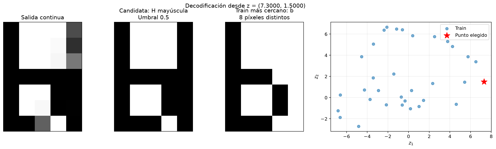

# Generación de una letra fuera del entrenamiento

## Candidata: H mayúscula



Se usó un AE entrenado con los **32 patrones originales** de `font.h`, con arquitectura `35-24-12-2-12-24-35`. La corrida elegida, semilla 1, reconstruye los 32 patrones sin errores al umbralizar a 0.5. Las etiquetas del entrenamiento contienen letras minúsculas y símbolos, pero no la `H` mayúscula.

Se decodificó `z = (7.3, 1.5)` y se binarizó la salida con umbral 0.5. La forma resultante puede interpretarse como una **H mayúscula**, aunque tiene píxeles extra en la parte inferior y no es una representación perfecta:

```text
#...#
#...#
#...#
#####
#..##
#..##
###.#
```

La comparación con los **32** bitmaps de entrenamiento da una distancia de Hamming mínima de **8 píxeles**, frente a la `b` minúscula. Por lo tanto, el bitmap binario no coincide con ningún patrón aprendido. Frente a una H de referencia con dos trazos verticales y una barra central, presenta cuatro píxeles extra. La identificación como H es un juicio visual, no una clasificación automática ni una garantía de que cualquier salida del espacio latente sea una letra.

## Cómo se eligió

El punto se **buscó deliberadamente**, no se muestreó al azar. Se exploraron grillas de 301×301 puntos en `[-15,15]²` para ocho corridas AE que reconstruían los 32 patrones, comparando las salidas binarizadas con referencias de letras mayúsculas. Para esta H se exigieron trazos verticales y una barra central conectada, y se escogió la candidata más próxima a la referencia entre las examinadas. Es una demostración guiada de lo que puede producir el decoder; no mide la frecuencia con que el modelo genera letras válidas.

Los puntos medios de experimentos anteriores entre `c`–`o` y `e`–`f` coincidían exactamente con `n` y `l` de train; por eso no se utilizan como prueba de una letra nueva.

## Reproducir

```bash
python -m scripts.preprocess_font
python -m scripts.run --config configs/ae_font_new_letter.yaml
python -m scripts.generate --mode new-letter \
  --run results/runs/ae_basic_adam_bce_a2f897b5_s1 \
  --z 7.3 1.5 --letter-name "H mayúscula" --output-dir figures/a4
```

Los pesos de la corrida están bajo `results/`, que Git ignora. La configuración reproduce la corrida escogida. El script comprueba la distancia a todos los patrones de entrenamiento y rechaza una coincidencia exacta.
