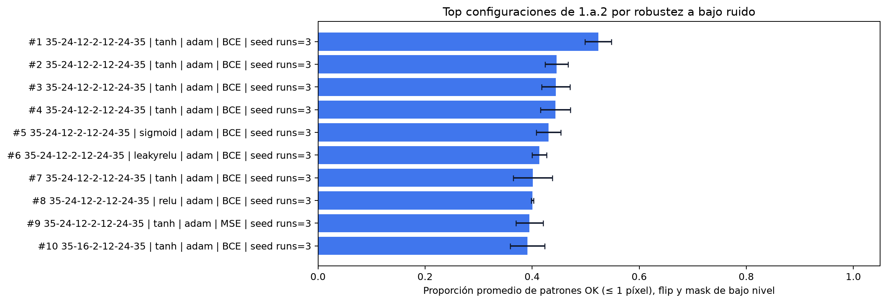
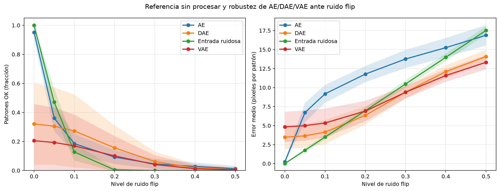
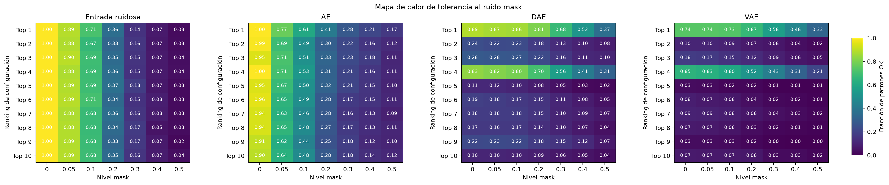

# Informe de resultados: Denoising Autoencoder (Parte 1.b)

## Resumen

Se evaluó la robustez de autoencoders sobre los 32 caracteres de `font.h`, representados como imágenes binarias de 7 × 5 píxeles. El estudio parte de las variaciones de hiperparámetros de 1.a.2 y compara tres modelos: el AE entrenado sin ruido, un DAE y un VAE de referencia entrenados con ruido `flip`.

El screening inicial contiene **48 corridas AE** (16 configuraciones y 3 semillas). Se seleccionaron las 10 configuraciones con mejor reconstrucción a bajo ruido. Para cada finalista se entrenaron **3 semillas de DAE y 3 de VAE**, todas durante 10.000 épocas: 30 corridas por tipo, 60 en total. Las 60 finalizaron con estado `ok`.

Los modelos se evaluaron con ruido de prueba `flip` y `mask` en niveles 0, 0.05, 0.1, 0.2, 0.3, 0.4 y 0.5. Se usaron 10 corrupciones reproducibles por nivel. `noise_eval.csv` contiene **16.800 observaciones**: 10 configuraciones × 3 semillas × 2 ruidos × 7 niveles × 10 pruebas × 4 referencias (entrada ruidosa, AE, DAE y VAE).

Para las comparaciones, cada DAE conservó los hiperparámetros y la semilla del AE finalista, y se entrenó con `flip=0.1` contra el patrón limpio. El VAE usó el mismo dataset, semilla y cuello latente de 2 dimensiones; la última capa latente determinista se reemplazó por las cabezas `mu` y `logvar`, con `beta=1` y warmup de 100 épocas.

## Cómo leer las métricas

- **Patrón OK**: carácter reconstruido con como máximo 1 píxel distinto del original, luego de umbralizar la salida en 0.5.
- **Fracción de patrones OK**: proporción de los 32 caracteres que cumplen ese criterio. En las gráficas se muestra entre 0 y 1.
- **Error medio**: promedio de píxeles distintos por carácter.
- Las curvas resumen las 10 configuraciones finalistas y sus semillas; las bandas muestran ±1 desvío estándar. Los mapas de calor desglosan el resultado por ranking.
- La referencia **Entrada ruidosa** no aplica un modelo: compara directamente el patrón corrompido contra el original. Sirve para medir si reconstruir aporta una mejora real.
- Las salidas de AE/DAE/VAE son probabilidades por píxel. Las imágenes pueden verse grises; las métricas se calculan después del umbral 0.5.

## Selección de las 10 configuraciones

El ranking promedia la fracción de patrones OK ante `flip` y `mask` con niveles bajos 0.05 y 0.1, y luego promedia las 3 semillas. La desviación se expresa en puntos porcentuales.

| Puesto | Arquitectura | Activación | Pérdida | Optimizador, LR y schedule | Inicialización / batch | OK promedio | Desvío |
|---:|---|---|---|---|---|---:|---:|
| 1 | Medium | tanh | BCE | Adam, 0.01, exp_decay | Xavier / full | 52.34% | 2.47 pp |
| 2 | Medium | tanh | BCE | Adam, 0.001, exp_decay | He / full | 44.58% | 2.15 pp |
| 3 | Medium | tanh | BCE | Adam, 0.001, exp_decay | Xavier / 8 | 44.43% | 2.64 pp |
| 4 | Medium | tanh | BCE | Adam, 0.001, constant | Xavier / full | 44.35% | 2.79 pp |
| 5 | Medium | sigmoid | BCE | Adam, 0.001, exp_decay | Xavier / full | 43.05% | 2.31 pp |
| 6 | Medium | leaky ReLU | BCE | Adam, 0.001, exp_decay | Xavier / full | 41.33% | 1.36 pp |
| 7 | Medium | tanh | BCE | Adam, 0.001, exp_decay | Xavier / full | 40.13% | 3.67 pp |
| 8 | Medium | ReLU | BCE | Adam, 0.001, exp_decay | Xavier / full | 40.08% | 0.21 pp |
| 9 | Medium | tanh | MSE | Adam, 0.001, exp_decay | Xavier / full | 39.51% | 2.55 pp |
| 10 | Small | tanh | BCE | Adam, 0.001, exp_decay | Xavier / full | 39.14% | 3.21 pp |

Las 10 mejores configuraciones provienen principalmente de la arquitectura Medium y usan Adam. La mejor fue Medium/tanh/BCE con `lr=0.01` y `exp_decay`, con 52.34% de patrones OK a bajo ruido. La tabla completa, incluyendo los identificadores de las tres corridas fuente, está en [`shortlist.csv`](../../results/denoising/shortlist.csv).

En esta tabla, Medium corresponde a `35-24-12-2-12-24-35`; Small corresponde a `35-16-2-12-24-35`.

### Ranking de bajo ruido



Cada barra es el promedio ante los cuatro casos de bajo ruido (`flip`/`mask` en 0.05/0.1). Las barras de error reflejan variación entre semillas. El ranking se usa para elegir candidatos, no predice por sí solo cuál DAE será mejor: el entrenamiento con ruido cambia el comportamiento de cada configuración, como muestran los mapas de calor.

## Curvas de robustez

### Ruido `flip`



En promedio sobre las 10 configuraciones, con `flip=0.1` el DAE logra **27.2%** de patrones OK, frente a 18.5% del AE, 17.0% del VAE y 12.8% de la entrada sin procesar. En `flip=0.2`, el DAE conserva la ventaja (15.6%, comparado con 9.2% AE, 10.1% VAE y 0.4% entrada).

La ventaja no se mantiene igual en todos los niveles. En `flip=0.05`, la entrada sin procesar alcanza 47.1% de patrones OK y supera al promedio DAE (30.5%); a niveles 0.4–0.5 la fracción de patrones OK de todos los modelos se acerca a cero. Aunque el error medio del DAE sigue siendo menor que el del AE en esos niveles altos, ya casi ningún carácter satisface el umbral estricto de 1 píxel.

### Ruido `mask`


Con `mask` bajo, la entrada sin procesar y el AE superan al promedio de los DAE en fracción OK: a nivel 0.1 obtienen 68.8% y 49.8%, respectivamente, frente a 30.9% del DAE. Desde nivel 0.3, el DAE queda ligeramente por encima en fracción OK (21.1% frente a 20.0% AE y 15.8% entrada); a nivel 0.5 la diferencia entre DAE y AE es pequeña (11.6% y 11.4%).

El error medio aporta otra perspectiva: desde `mask=0.1`, el DAE tiene menor error medio que el AE (3.68 frente a 4.91 píxeles en 0.1; 7.69 frente a 10.41 en 0.5). La entrada sin procesar puede conservar un error medio bajo porque `mask` sólo convierte píxeles en cero, pero eso no implica que reconstruya bien los caracteres completos.

## Mapas de calor por configuración

Cada fila es una configuración del ranking y cada celda indica su fracción de patrones OK. La primera columna es la entrada ruidosa; las siguientes muestran AE, DAE y VAE. Los mapas permiten ver la variabilidad que queda oculta en las curvas promedio.

### `flip`


La configuración Top 1 destaca: su DAE mantiene 80.5% de patrones OK en `flip=0.1`, 48.1% en 0.2 y 18.4% en 0.3. Top 4 también es relativamente resistente (69.3%, 38.8% y 15.5% en esos niveles). La mayoría de las otras configuraciones cae mucho antes; por eso no conviene interpretar el promedio como si todos los DAE fueran igualmente robustos.

### `mask`



El DAE Top 1 obtiene 85.9% de patrones OK en `mask=0.1`, 67.6% en 0.3 y 36.7% en 0.5. Top 4 es el segundo candidato destacado: 79.6%, 56.0% y 31.4% en esos niveles. En los demás puestos hay variación importante y varios modelos pierden precisión incluso con poco ruido.

## Ejemplos cualitativos

Las columnas muestran niveles crecientes (0.1, 0.3 y 0.5); las filas comparan originales, entradas ruidosas y reconstrucciones de AE, DAE y VAE para una muestra del Top 1. Son ejemplos ilustrativos, no promedios estadísticos.

### `flip`


Al aumentar `flip`, la entrada queda muy alterada. El DAE conserva mejor la estructura en los niveles intermedios que el AE de referencia, aunque a 0.5 también pierde legibilidad. El VAE produce salidas más suaves, pero no recupera todos los caracteres correctamente.

### `mask`


El DAE y el VAE pueden recuperar partes que fueron ocultadas, especialmente en niveles intermedios. El resultado depende del carácter y del ruido concreto; el Top 1 del DAE es el que mejor se sostiene en el mapa de calor agregado.

## Conclusiones

1. **La mejor configuración de bajo ruido también fue una buena base para DAE**, pero no todos los finalistas conservaron esa robustez después de entrenarse con ruido. Top 1 y Top 4 fueron los DAE más resistentes; los demás tuvieron resultados bastante inferiores.
2. **El DAE favorece la reconstrucción bajo `flip` moderado**, particularmente entre 0.1 y 0.3. Bajo `mask`, la mejora sobre el AE aparece sobre todo en niveles altos y depende de la configuración.
3. **Existe un compromiso con la reconstrucción limpia**: en el promedio de finalistas a nivel 0, el AE obtiene 95.2% OK y 0.23 píxeles de error medio; el DAE, 32.1% y 3.48 píxeles; el VAE, 20.5% y 4.82 píxeles. Al entrenarse para denoising, parte de la fidelidad en limpio se sacrifica.
4. **El VAE de referencia no supera en promedio al DAE/AE en este conjunto binario pequeño**, aunque en el Top 1 mantiene resultados competitivos bajo ruido moderado. Es una comparación sobre `font.h`; no reemplaza los experimentos de VAE con sprites de la Parte 2.
5. Si se debe elegir una configuración para denoising, **Top 1 es la recomendación principal** y **Top 4 una alternativa**. La decisión depende del ruido esperado: Top 1 es notablemente fuerte ante `mask` y conserva ventaja ante `flip` moderado.

## Archivos de resultados y reproducción

- [`low_noise_eval.csv`](../../results/denoising/low_noise_eval.csv): métricas de los AE de screening ante bajo ruido.
- [`shortlist.csv`](../../results/denoising/shortlist.csv): ranking y corridas seleccionadas.
- [`noise_eval.csv`](../../results/denoising/noise_eval.csv): métricas por modelo, configuración, semilla, ruido, nivel y prueba.
- [`scripts/noise_eval.py`](../../scripts/noise_eval.py): selección, evaluación y generación de gráficos.

Para recalcular las métricas y regenerar las figuras usando los pesos ya entrenados, sin volver a entrenar DAE/VAE:

```bash
python scripts/noise_eval.py \
  --summary results/summary/runs.csv \
  --runs-dir results/runs \
  --output-dir results/denoising \
  --figures-dir figures/b \
  --top-n 10 \
  --skip-training
```
