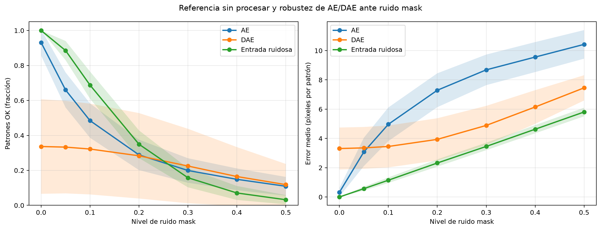
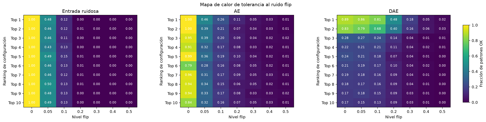
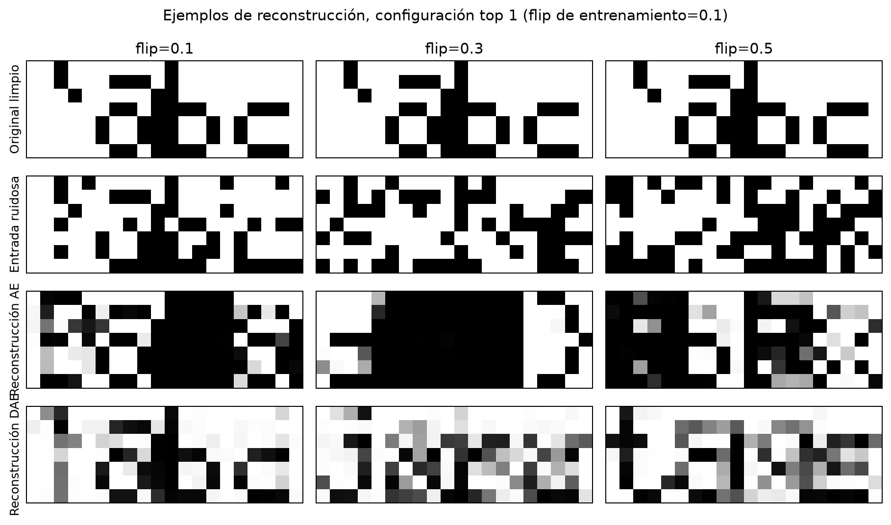
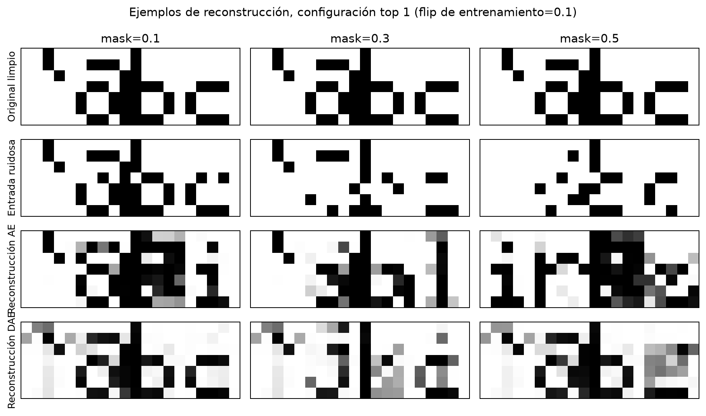

# Informe de resultados: Denoising Autoencoder (Parte 1.b)

## Metodología revisada

Se trabajó con los 32 patrones binarios de `font.h`, de 7×5 píxeles. El screening de 1.a.2 aportó **16 configuraciones únicas y tres semillas**. Se entrenó un DAE para cada una de las 48 corridas fuente, con los mismos hiperparámetros y `flip=0.1`; la pérdida compara la salida con el patrón limpio.

El **Top 10 se seleccionó directamente por el desempeño de los DAEs**: media de la fracción de patrones OK ante `flip` y `mask` a niveles 0.05 y 0.1, promediada entre semillas y corrupciones. Los AE de origen se evaluaron también, pero sólo como comparación pareada. **No se usaron VAEs en 1.b.**

Los 10 finalistas (30 DAEs) y sus 30 AE de referencia se evaluaron con ambos ruidos en niveles 0, 0.05, 0.1, 0.2, 0.3, 0.4 y 0.5, con 10 corrupciones reproducibles por nivel. `noise_eval.csv` contiene **12.600 registros**: 10 configuraciones × 3 semillas × 2 ruidos × 7 niveles × 10 pruebas × 3 referencias (entrada ruidosa, AE y DAE).

## Métricas y alcance

- **Patrón OK:** como máximo 1 píxel diferente del original, después de umbralizar la salida en 0.5.
- **Error medio:** promedio de píxeles distintos por patrón.
- El ranking promedia la fracción de patrones OK en los cuatro casos de bajo ruido. La desviación se calcula entre semillas.
- La referencia **Entrada ruidosa** evalúa directamente la corrupción, sin pasar por un modelo.
- Los 32 patrones de `font.h` se usaron tanto para entrenamiento como para esta evaluación. Las corrupciones son independientes y reproducibles, pero no constituyen una prueba de generalización a letras no vistas.

## Selección directa de configuraciones DAE


| Puesto | Arquitectura | Activación | Pérdida | Optimizador, LR, schedule | Inicialización / batch | Fracción OK DAE |
|---:|---|---|---|---|---|---:|
| 1 | Medium | tanh | BCE | Adam, 0.01, exp_decay | Xavier / full | 84.9% ± 10.1 pp |
| 2 | Medium | tanh | BCE | Adam, 0.001, constant | Xavier / full | 76.9% ± 5.3 pp |
| 3 | Medium | tanh | BCE | Adam, 0.001, exp_decay | Xavier / 8 | 26.1% ± 3.7 pp |
| 4 | Medium | tanh | MSE | Adam, 0.001, exp_decay | Xavier / full | 21.0% ± 3.4 pp |
| 5 | Medium | tanh | BCE | Adam, 0.001, exp_decay | He / full | 20.7% ± 5.9 pp |
| 6 | Deep | tanh | BCE | Adam, 0.001, exp_decay | Xavier / full | 19.3% ± 0.9 pp |
| 7 | Medium | leaky ReLU | BCE | Adam, 0.001, exp_decay | Xavier / full | 17.3% ± 6.3 pp |
| 8 | Medium | tanh | BCE | Adam, 0.001, exp_decay | Xavier / full | 17.0% ± 4.4 pp |
| 9 | Medium | ReLU | BCE | Adam, 0.001, exp_decay | Xavier / full | 16.7% ± 5.4 pp |
| 10 | Medium | tanh | BCE | RMSprop, 0.001, exp_decay | Xavier / full | 15.0% ± 1.2 pp |

Medium corresponde a `35-24-12-2-12-24-35`; Deep a `35-30-20-10-2-12-24-35`. La brecha entre el Top 2 y el resto es marcada: el comportamiento de un DAE no se predice bien sólo a partir del AE que comparte su configuración. [`shortlist.csv`](../../results/denoising/shortlist.csv) contiene los identificadores de origen y todas las métricas.

## ¿Por qué el DAE parece rendir peor que el AE?

La respuesta depende del nivel de ruido y de la métrica:

1. **Se sacrifica reconstrucción exacta en limpio.** En el conjunto finalista, a nivel 0 el AE logra 93.1% de patrones OK y 0.32 píxeles de error medio; el DAE, 33.6% y 3.31 píxeles. El DAE se entrena para reconstruir desde una entrada alterada, no para memorizar la identidad exacta `x → x`; su objetivo cambia intencionalmente.
2. **El criterio “OK” es muy estricto.** Cuenta como fallo una salida con dos píxeles incorrectos, aunque visualmente sea casi idéntica. Por eso también se informa el error medio, que muestra mejoras del DAE incluso cuando la fracción OK es menor.
3. **La shortlist anterior usaba el AE como proxy.** Eso favorecía candidatos que funcionaban bien como AE, no necesariamente como DAE. La metodología corregida entrena y evalúa DAEs para elegir el Top 10; el AE sólo queda como control pareado.
4. **El ruido de entrenamiento no cubre todos los ruidos de prueba.** Se entrena con `flip=0.1`; `mask` mide transferencia a otra corrupción, no optimizada directamente.
5. **El problema es pequeño y el cuello de botella es 2D.** Sólo hay 32 patrones. El resultado depende sensiblemente de la configuración y de la semilla; el agregado del Top 10 oculta que los dos primeros puestos son mucho mejores que los siguientes.

Así, “peor que el AE” describe principalmente la reconstrucción sin ruido y, en `mask` bajo, la fracción de caracteres que cae dentro del umbral de un píxel. **No significa que el DAE no aprenda a quitar ruido:** a `flip=0.1`, por ejemplo, su promedio es 28.8% OK y 3.94 píxeles de error, frente a 18.4% y 9.21 píxeles del AE.

## Robustez promedio

### Ruido `flip`


| Nivel | Entrada ruidosa OK | AE OK | DAE OK | Error medio AE | Error medio DAE |
|---:|---:|---:|---:|---:|---:|
| 0.05 | 47.1% | 34.9% | 32.2% | 6.76 | 3.48 |
| 0.1 | 12.8% | 18.4% | **28.8%** | 9.21 | **3.94** |
| 0.2 | 0.4% | 8.3% | **16.6%** | 11.79 | **6.09** |
| 0.3 | 0.0% | 4.3% | **6.4%** | 13.75 | **9.25** |
| 0.5 | 0.0% | 1.2% | 0.7% | 16.82 | **14.15** |

El DAE supera al AE en bajo error para niveles moderados (0.1–0.3), pero a 0.05 la entrada sin procesar conserva más patrones dentro del umbral estricto. En 0.5, ninguno recupera muchos patrones completos, aunque el DAE reduce el error medio.

### Ruido `mask`



| Nivel | Entrada ruidosa OK | AE OK | DAE OK | Error medio AE | Error medio DAE |
|---:|---:|---:|---:|---:|---:|
| 0.05 | 88.5% | 66.0% | 33.3% | 3.08 | 3.36 |
| 0.1 | 68.8% | 48.4% | 32.2% | 4.97 | **3.45** |
| 0.2 | 34.9% | 28.9% | 28.3% | 7.29 | **3.94** |
| 0.3 | 15.8% | 19.9% | **22.5%** | 8.69 | **4.89** |
| 0.5 | 3.2% | 10.9% | **11.9%** | 10.43 | **7.46** |

El DAE no es una mejora uniforme para `mask`: a niveles bajos el AE o incluso la entrada sin procesar obtienen más patrones OK, mientras que a niveles medios/altos el DAE supera levemente al AE y reduce el error medio.

## Variación por configuración




El Top 1 es el candidato más consistente: a `flip=0.1` obtiene 80.5% de patrones OK; a `mask=0.1`, 85.9%; y conserva 36.7% OK incluso en `mask=0.5`. El Top 2 también es fuerte en ruido moderado (68.3% OK en `flip=0.1`, 79.2% en `mask=0.1`). Los puestos inferiores muestran por qué era necesario rankear los propios DAEs.





Las imágenes corresponden al Top 1 y son ejemplos ilustrativos; las tablas y los mapas agregan semillas y corrupciones distintas.

## Conclusiones

1. El Top 10 se define ahora por resultados DAE, mientras el AE aporta el contraste pedido.
2. El DAE paga un costo claro en reconstrucción limpia, pero mejora tanto la fracción OK como el error promedio frente al AE en `flip` moderado.
3. Ante `mask`, la mejora depende del nivel: aparece principalmente a niveles medios/altos. La entrada sin procesar ya es una referencia competitiva con `mask` bajo.
4. El Top 1 es una recomendación fuerte para estas condiciones; no debe generalizarse a otras tasas de ruido, datasets o semillas sin una evaluación adicional.

## Artefactos y reproducción

- [`low_noise_eval.csv`](../../results/denoising/low_noise_eval.csv): métricas de todos los AE de referencia y DAEs de screening a bajo ruido.
- [`shortlist.csv`](../../results/denoising/shortlist.csv): Top 10 clasificado por DAE.
- [`model_pairs.csv`](../../results/denoising/model_pairs.csv): correspondencia AE–DAE por semilla.
- [`noise_eval.csv`](../../results/denoising/noise_eval.csv): evaluación final del Top 10.
- [`scripts/noise_eval.py`](../../scripts/noise_eval.py): entrenamiento del screening, selección, contraste y gráficos.

Desde la raíz del repositorio:

```bash
python scripts/preprocess_font.py
python scripts/sweep.py --sweep configs/sweeps/a2_screening.yaml
python scripts/noise_eval.py --summary results/summary/runs.csv \
  --runs-dir results/runs --output-dir results/denoising \
  --figures-dir figures/b --top-n 10
```

Para regenerar las tablas y figuras sin reentrenar, agregar `--skip-training` cuando existan `model_pairs.csv` y los pesos de todos los DAEs evaluados.
