# Informe de resultados: VAE sobre sprites

## Objetivo y metodología

La Parte 2 estudia si un Autoencoder Variacional puede representar, reconstruir e interpolar el dataset de sprites, y cómo influyen la regularización y la dimensión latente. Se usó `data/processed/sprites.npz`, sin volver a procesarlo: **790 muestras RGB 16×16 para entrenamiento y 197 para validación**, con 768 valores por imagen en `[0,1]`.

Se entrenaron **24 modelos durante 500 épocas**, todos con estado `ok`:

- **3 AE deterministas** de control, dimensión latente 2, con las mismas semillas que los VAE.
- **21 VAE** con semillas 42, 101 y 202. El diseño OFAT compara β=0.1/0.5/1/2 con dimensión 16; dimensiones 2/8/16 con β=1; y warmup de β de 0 frente a 50 épocas con dimensión 16 y β=1. Las condiciones compartidas se reutilizaron, no se repitieron.

La pérdida MSE del proyecto suma los errores cuadrados de los 768 canales/píxeles por imagen y promedia sobre las muestras. Por eso las cifras no están normalizadas por 768. En las tablas se informa la media ± desvío estándar entre tres semillas. La pérdida total de VAE es `recon_loss + beta * kl_loss`.

El VAE de mejor MSE de validación fue el de **β=0.5, dimensión 16 y warmup de 50 épocas** (semilla 42): MSE de validación 17.439. Se usa para la figura de reconstrucciones y para generar desde el prior. Para visualizar el plano latente y comparar interpolaciones en dos dimensiones se usa el modelo β=1, `z=2`, warmup=50.

## Dataset


La figura presenta 64 sprites de entrenamiento seleccionados de forma reproducible. El dataset no contiene etiquetas semánticas para las clases de sprites; por ello, el color del scatter latente se identifica con la fila de origen en el tileset y no debe interpretarse como una categoría.

## Evolución de la optimización y selección de β

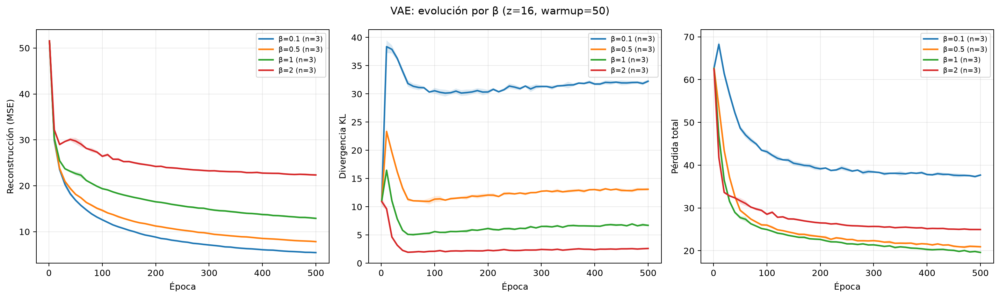

La figura muestra la media y ±1 desvío estándar entre semillas para `z=16` y warmup=50. Al aumentar β, la KL cae y se impone mayor regularidad, pero la reconstrucción pierde precisión.

| β | MSE validación | Reconstrucción train | KL | Pérdida total |
|---:|---:|---:|---:|---:|
| 0.1 | 18.394 ± 0.036 | 5.441 ± 0.024 | 32.245 ± 0.296 | 37.686 ± 0.297 |
| 0.5 | **17.777 ± 0.293** | 7.835 ± 0.070 | 13.096 ± 0.296 | 20.930 ± 0.254 |
| 1.0 | 19.662 ± 0.155 | 12.901 ± 0.236 | 6.707 ± 0.157 | 19.608 ± 0.080 |
| 2.0 | 24.513 ± 0.325 | 22.355 ± 0.264 | **2.606 ± 0.085** | 24.961 ± 0.179 |

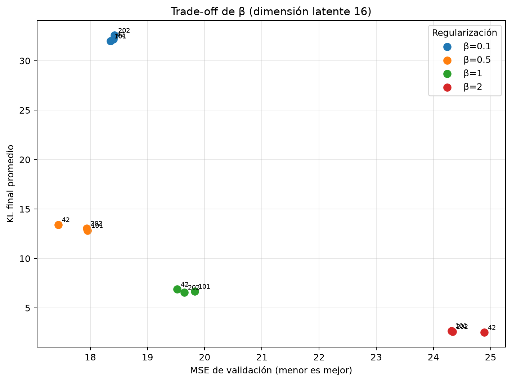

β=0.1 reconstruye muy bien el train, pero presenta KL alta, es decir, una distribución latente menos cercana al prior. β=2 fuerza más la regularización y obtiene la KL más baja a costa de una reconstrucción notablemente peor. **β=0.5 ofrece el mejor equilibrio medido en validación para estos experimentos.**

## Dimensión latente

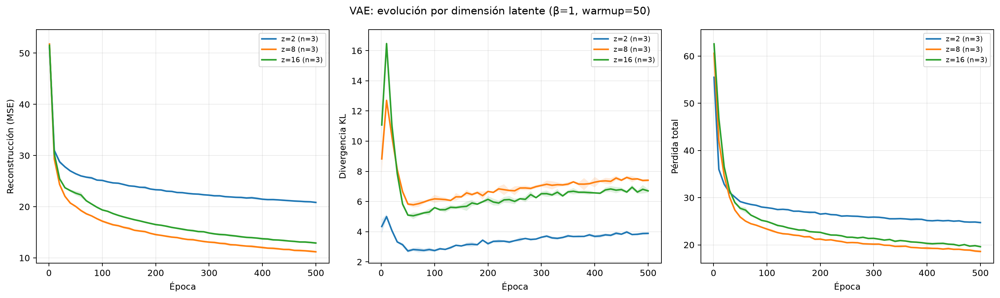

Comparación para β=1 y warmup=50:

| Dimensión | MSE validación | Reconstrucción train | KL |
|---:|---:|---:|---:|
| 2 | 25.669 ± 0.346 | 20.832 ± 0.167 | 3.889 ± 0.086 |
| 8 | 19.856 ± 0.133 | **11.190 ± 0.217** | 7.409 ± 0.105 |
| 16 | **19.662 ± 0.155** | 12.901 ± 0.236 | 6.707 ± 0.157 |

El espacio de 2 dimensiones es más fácil de dibujar, pero pierde información de reconstrucción. Pasar de 2 a 8 dimensiones mejora mucho el MSE de validación; 16 apenas mejora la validación respecto de 8 y no mejora el MSE de train. Para la generación general conviene usar 16 por su mejor validación dentro de esta comparación, mientras que 2 dimensiones se conserva para las figuras interpretables.

## Efecto del warmup

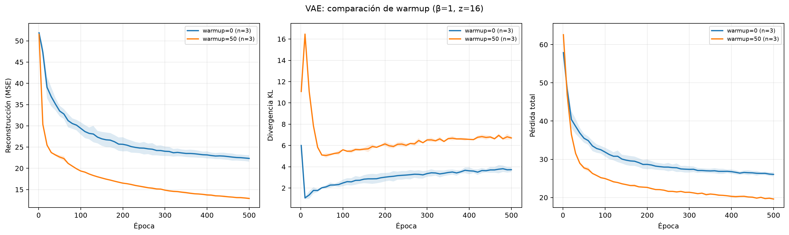

Para β=1 y dimensión 16, el warmup de 50 épocas obtuvo MSE de validación **19.662 ± 0.155**, frente a **24.465 ± 0.703** sin warmup. La reconstrucción de train también fue mejor (12.901 frente a 22.329). Sin warmup se observa KL final menor (3.721 frente a 6.707), pero esa regularización adicional no compensó el deterioro de reconstrucción. En estas condiciones, el warmup mejoró el balance de entrenamiento.

## Espacio latente y naturaleza probabilística

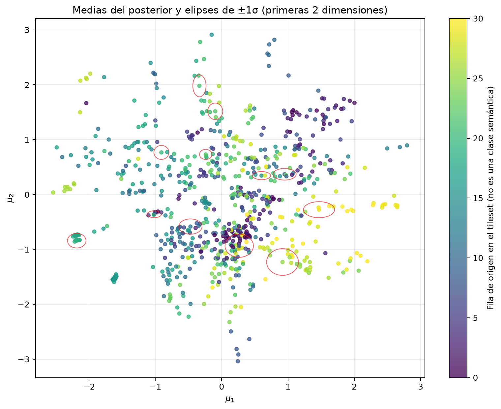

Cada punto representa la media `μ` de un sprite en las dos primeras dimensiones latentes del VAE `z=2`. Las elipses rojas ilustran ±1σ, calculado a partir de `exp(0.5 * logvar)`, en algunas muestras. La dispersión hace visible que el encoder produce distribuciones, no sólo coordenadas deterministas. No se asignaron clases semánticas: el color indica fila del tileset.

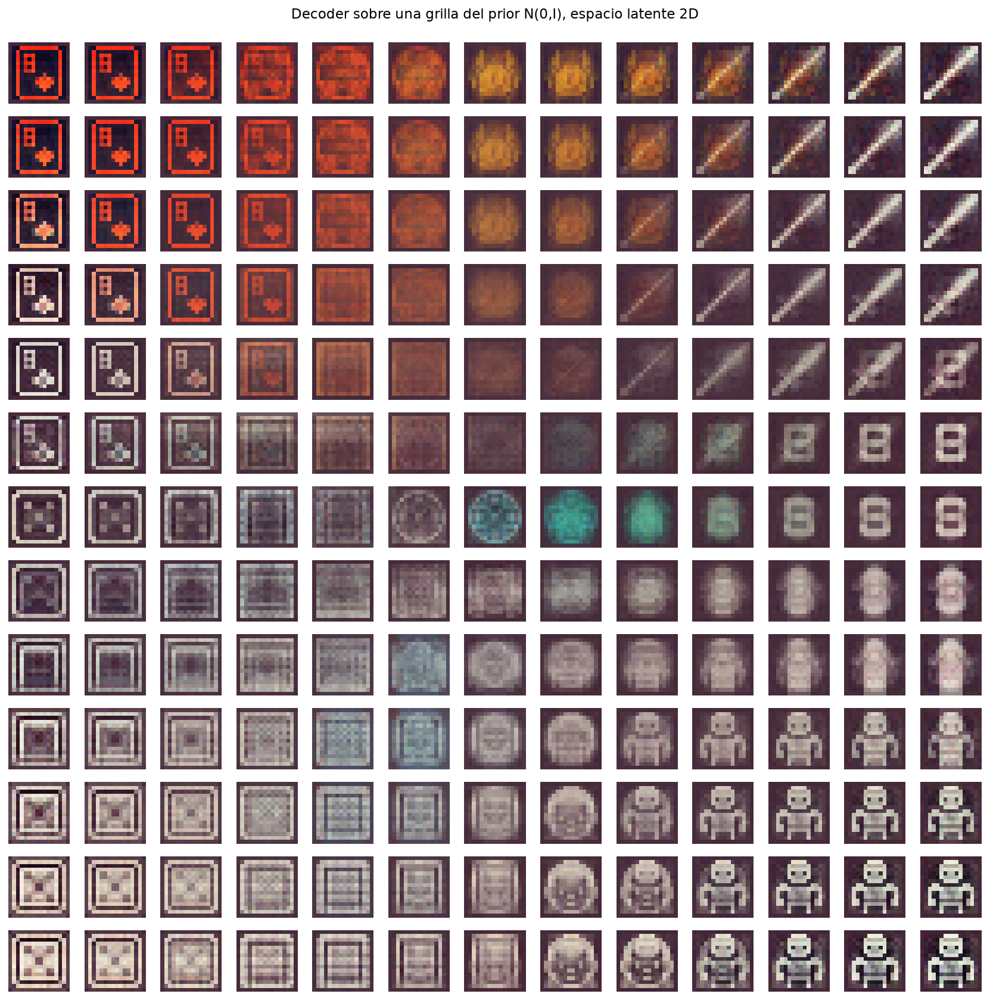

El decoder se evalúa sobre una malla regular de `[-2.5,2.5]²`. Aparecen transiciones graduales entre formas y paletas, aunque varios puntos intermedios son borrosos o mezclas de sprites. La grilla es ilustrativa del modelo de dimensión 2; no representa la totalidad del espacio latente del VAE de 16 dimensiones.

## Reconstrucciones y comparación determinista

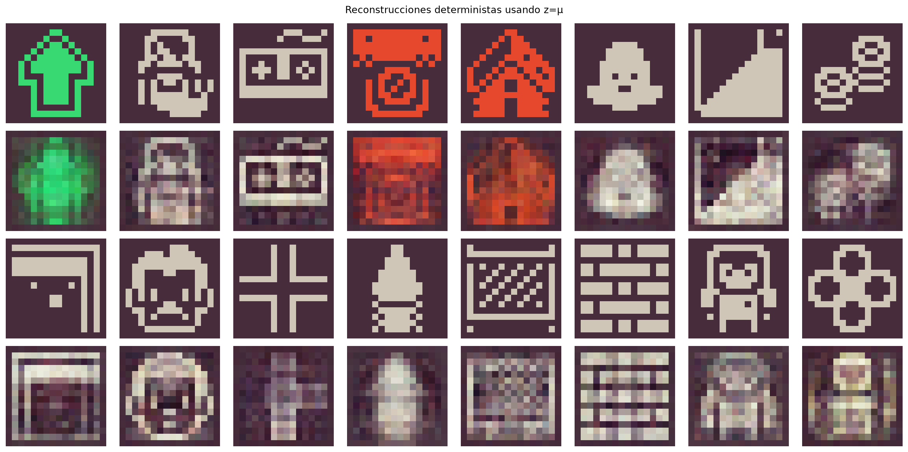

Las reconstrucciones se calculan de forma determinista decodificando `z=μ`, tanto para train como para validación. Se muestran con el mejor MSE de validación entre los VAE con warmup=50, β=0.5 y dimensión 16. Conservan estructuras y colores generales, pero pierden detalle fino y suavizan algunos bordes.

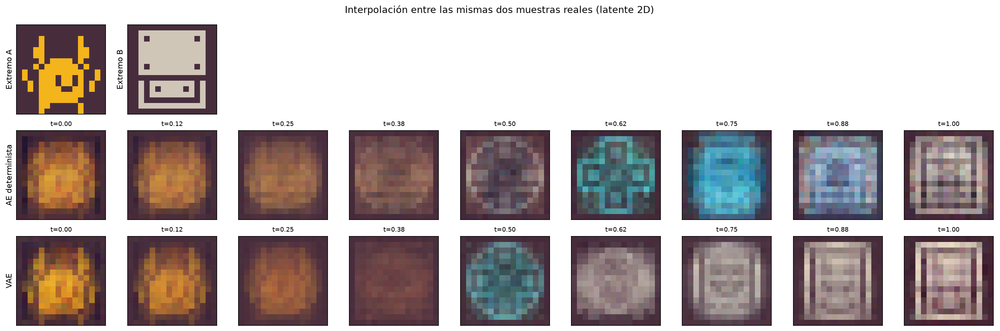

La interpolación usa los mismos dos sprites reales, escogidos como los más separados en el latente 2D del VAE. Las filas muestran los decodificados en nueve posiciones entre extremos, usando las coordenadas propias de cada encoder. El VAE genera una trayectoria continua, pero la continuidad no garantiza que cada punto intermedio sea un sprite nítido; el AE determinista también produce transiciones, aunque su espacio no está regularizado explícitamente hacia una normal.

En las tres semillas, la comparación de control 2D (β=1 y warmup=50 para el VAE) dio:

| Modelo | MSE validación | Reconstrucción train |
|---|---:|---:|
| AE determinista, z=2 | 29.070 ± 0.763 | **19.660 ± 0.331** |
| VAE, z=2 | **25.669 ± 0.346** | 20.832 ± 0.167 |

Con esta configuración, el AE ajusta algo mejor el train, mientras el VAE obtiene menor error de validación. Esta comparación es específica de estas arquitecturas, semillas y 500 épocas; no prueba que el VAE siempre supere a un AE.

## Muestreo desde el prior y muestra seleccionada

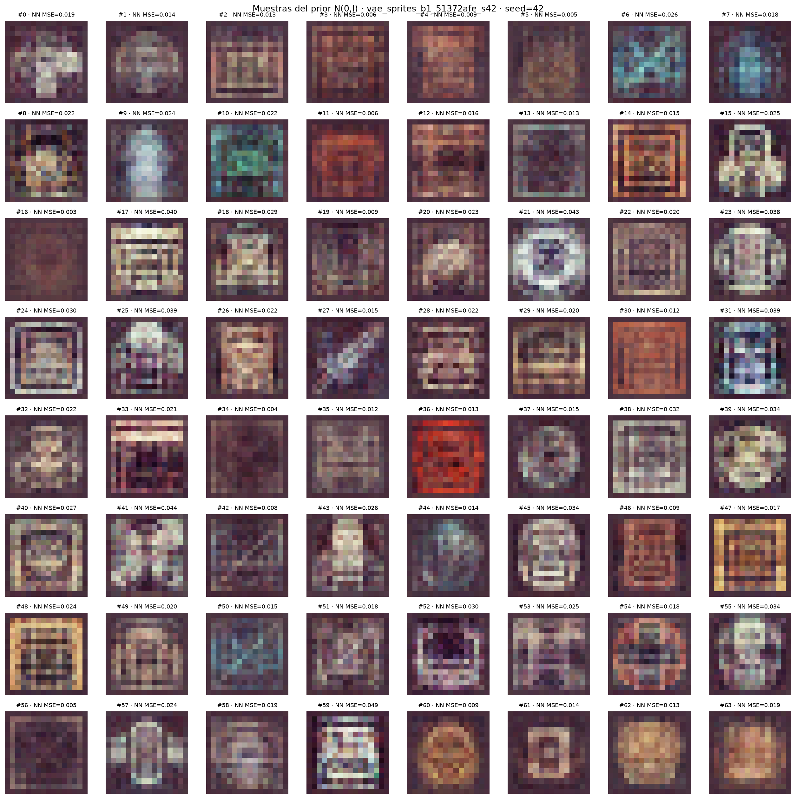

Se muestrearon 64 vectores `z ~ N(0,I)` con semilla 42 y se decodificaron con el VAE que obtuvo el mejor MSE de validación (β=0.5, `z=16`). Las salidas muestran variedad de siluetas y colores, aunque algunas son borrosas o poco definidas.

La muestra seleccionada para inspección es la **#23**:

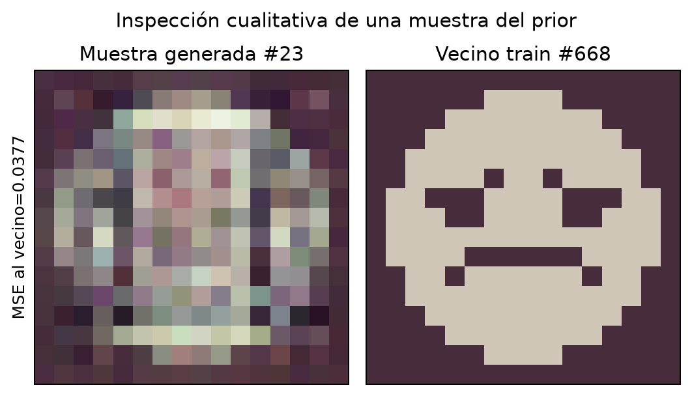

El criterio es cualitativo: la muestra parece un rostro/ícono estilizado reconocible, conserva una silueta compacta y una paleta compatible con el tileset, y no coincide visualmente con su vecino de entrenamiento más cercano. Ese vecino es el índice 668 y su MSE (promedio por feature, escala `[0,1]`) es **0.0377**. La distancia ayuda a detectar posibles copias, pero no es por sí sola una prueba de novedad ni de pertenencia; la selección final debe validarse visualmente por los autores.

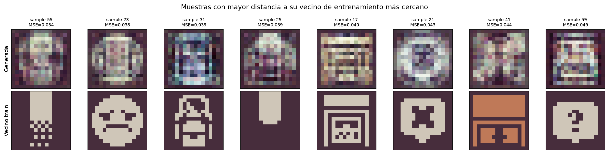

En las 64 muestras, el MSE al vecino de train más cercano tiene mediana 0.0193, mínimo 0.0030 y máximo 0.0494. La figura permite revisar algunas muestras más alejadas junto con sus vecinos y evaluar si la novedad aparente viene acompañada de una forma todavía plausible.

## Conclusiones

1. **β controla el compromiso reconstrucción–regularidad.** En estos resultados β=0.5 logra el menor MSE de validación, mientras β=2 da la KL menor y una reconstrucción peor.
2. **La dimensión latente 2 limita la fidelidad.** El salto a 8 dimensiones mejora marcadamente; 16 ofrece una mejora pequeña adicional en validación.
3. **El warmup fue útil** para β=1, `z=16`: la comparación de tres semillas muestra una reducción clara del MSE de validación.
4. **El VAE produjo interpolaciones y muestras del prior**, evidenciando un espacio continuo; no todas las salidas son nítidas, así que las muestras deben juzgarse también cualitativamente.
5. **La comparación AE/VAE es dependiente del protocolo.** El AE de control tuvo menor error en train, pero mayor en validación que el VAE 2D con warmup.

## Artefactos y comandos

- [`beta_curves.png`](./beta_curves.png), [`beta_tradeoff.png`](./beta_tradeoff.png): efecto de β.
- [`latent_dim_curves.png`](./latent_dim_curves.png): efecto de dimensión latente.
- [`beta_warmup_curves.png`](./beta_warmup_curves.png): comparación de warmup.
- [`latent_posterior_2d.png`](./latent_posterior_2d.png), [`latent_manifold_2d.png`](./latent_manifold_2d.png): espacio latente y decoder.
- [`reconstructions.png`](./reconstructions.png), [`ae_vae_interpolation.png`](./ae_vae_interpolation.png): reconstrucción e interpolación.
- [`prior_samples.png`](./prior_samples.png), [`prior_samples.npz`](./prior_samples.npz), [`prior_samples_nearest.csv`](./prior_samples_nearest.csv): muestras y vecinos más cercanos.
- Los historiales, pesos y métricas por corrida se guardan bajo `results/runs/` y `results/summary/runs.csv` (ignorados por Git).

Reproducir el experimento completo desde la raíz del repositorio (el dataset ya está preparado):

```bash
python scripts/sweep.py --sweep configs/sweeps/ae_sprites.yaml
python scripts/sweep.py --sweep configs/sweeps/vae_sprites.yaml
python scripts/plot_vae.py --summary results/summary/runs.csv --runs-dir results/runs \
  --data data/processed/sprites.npz --output-dir figures/vae
python scripts/generate.py --mode sample --summary results/summary/runs.csv \
  --output-dir figures/vae --n-samples 64 --seed 42 --selected-sample 23
```
