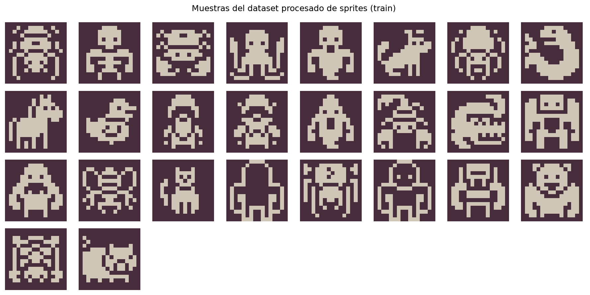
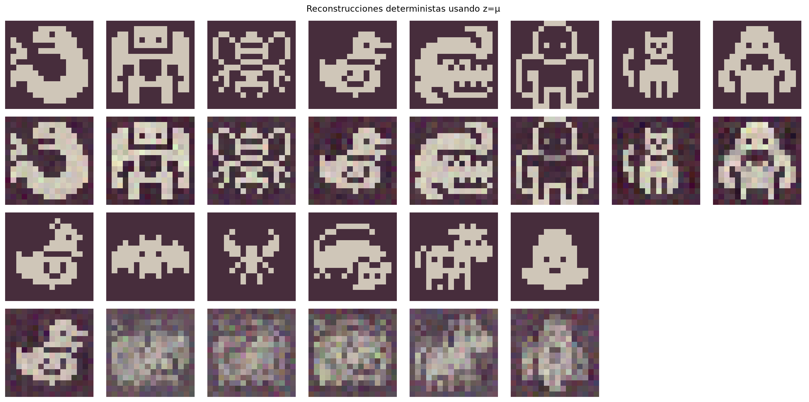
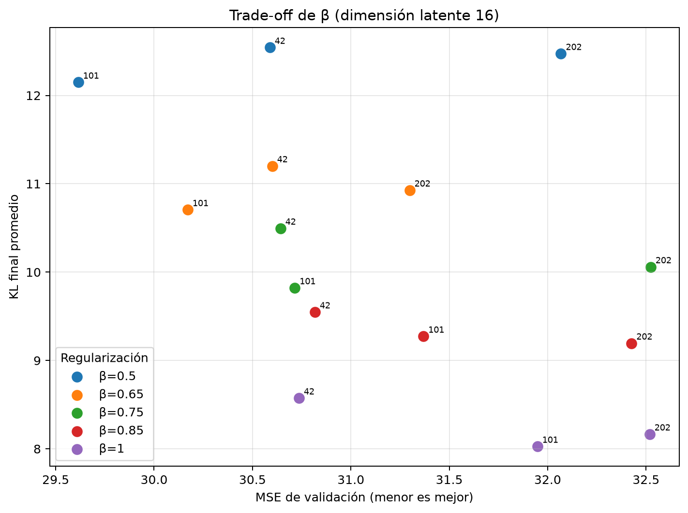
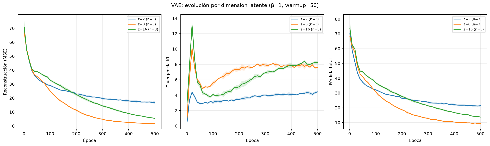
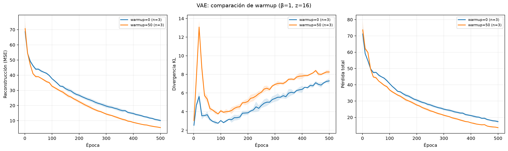
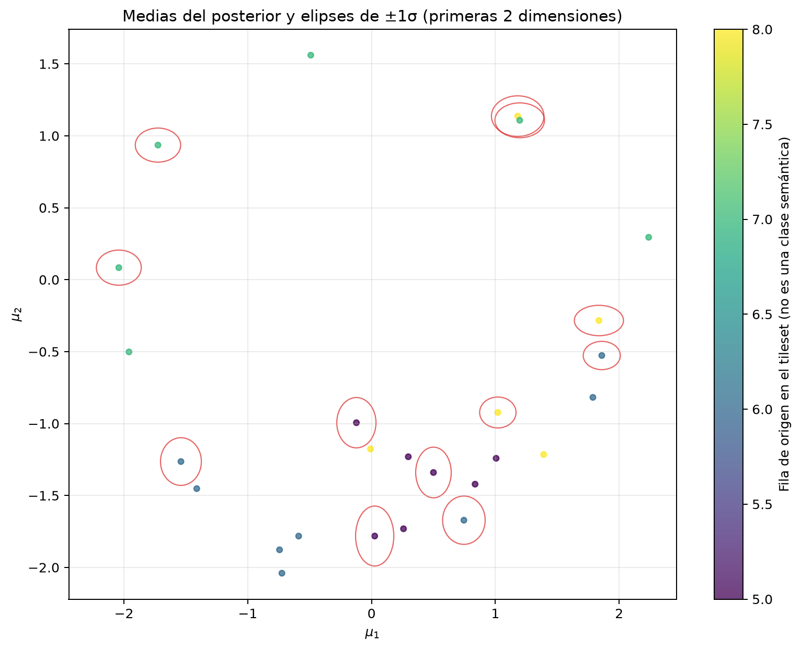
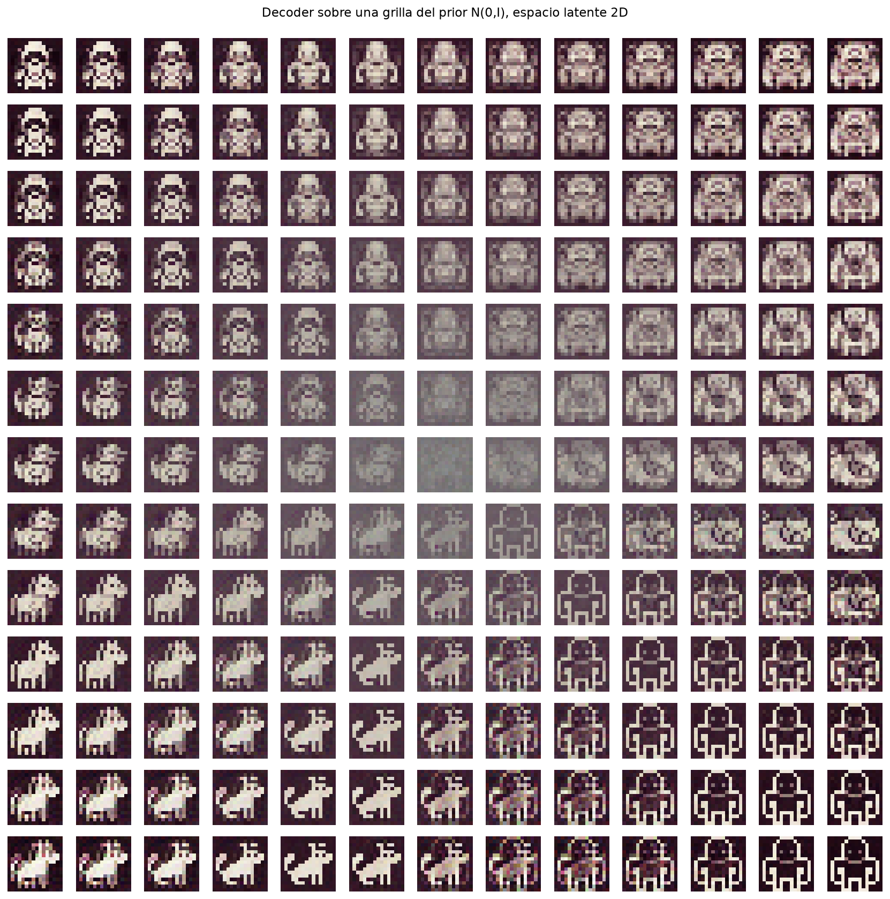
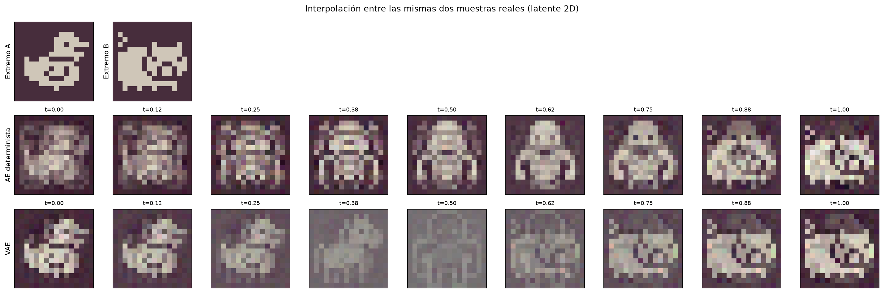
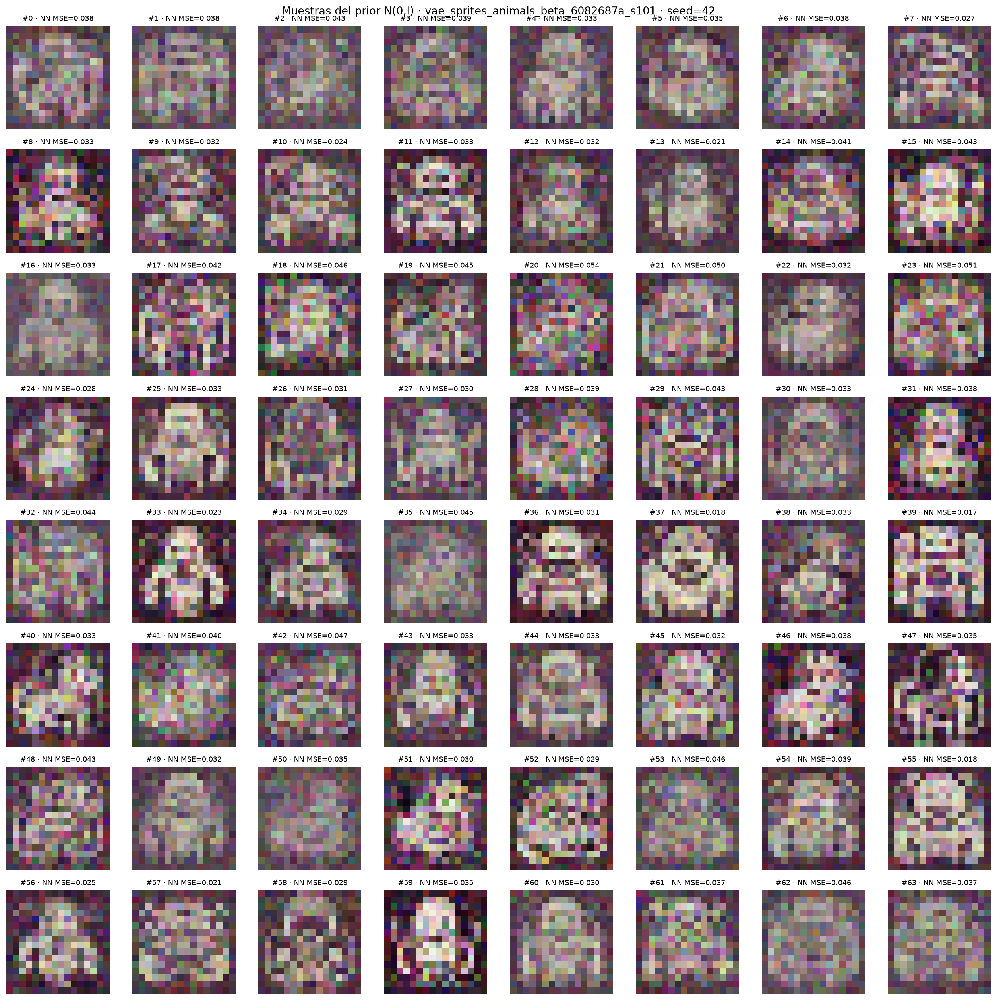
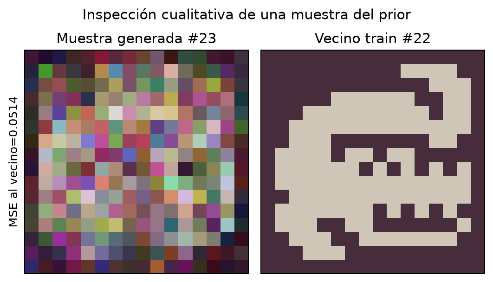

# Experimento VAE con subset regional de sprites

## Pregunta y protocolo

Se probó si un subset espacial más pequeño del tileset y valores de β entre 0.5 y 1 mejoraban el ajuste observado en el experimento completo. Se tomó la región `animales` de [`configs/dataset_sprites.yaml`](../../configs/dataset_sprites.yaml): filas 5–8 y columnas 24–31. Tras deduplicar quedan **32 imágenes RGB 16×16**, divididas en **26 de entrenamiento y 6 de validación**. El dataset completo `data/processed/sprites.npz` no se modificó.

Se entrenaron **24 VAE y 3 AE de control**, durante 500 épocas y con semillas 42, 101 y 202. Los barridos comparan β ∈ {0.5, 0.65, 0.75, 0.85, 1.0}, dimensión latente 2/8/16 y warmup 0/50. β, dimensión y warmup se varían por separado; las condiciones repetidas se comparten. Las tablas reportan media ± desvío estándar muestral entre semillas.

El MSE suma los errores de los 768 canales por sprite y promedia sobre las muestras. No está dividido por 768. Como el conjunto de validación sólo tiene seis imágenes, sus medias son sensibles a qué ejemplos cayeron en ese split; se interpretan como evidencia exploratoria, no como una estimación estable de generalización.

## Dataset y reconstrucciones





El entrenamiento logra errores bajos en algunas configuraciones, pero las reconstrucciones de validación son más variables. En el conjunto de dimensión 16 y warmup=50, β=0.65 obtiene MSE de entrenamiento 2.114 y MSE de validación 30.690: una brecha grande compatible con sobreajuste al subset pequeño.

## Barrido fino de β



Comparación para dimensión 16 y warmup=50:

| β | MSE validación | MSE train | KL train | Pérdida total train |
|---:|---:|---:|---:|---:|
| 0.50 | 30.757 ± 1.235 | 1.574 ± 0.029 | 12.388 ± 0.210 | 13.962 |
| **0.65** | **30.690 ± 0.569** | 2.114 ± 0.064 | 10.945 ± 0.248 | 13.060 |
| 0.75 | 31.294 ± 1.066 | 2.858 ± 0.128 | 10.126 ± 0.342 | 12.983 |
| 0.85 | 31.537 ± 0.818 | 3.376 ± 0.094 | 9.339 ± 0.185 | 12.715 |
| 1.00 | 31.734 ± 0.910 | 5.444 ± 0.360 | 8.256 ± 0.284 | 13.699 |

El menor promedio observado de validación fue β=0.65, pero la diferencia frente a β=0.5 es apenas 0.067 y la validación tiene seis sprites. **No alcanza para concluir que 0.65 sea realmente mejor**: los resultados apuntan a un mínimo amplio entre 0.5 y 0.75, sin justificar una precisión mayor que la incertidumbre del split. β mayores reducen la KL y empeoran suavemente el MSE de validación.

El modelo con el menor MSE de validación individual fue β=0.5, semilla 101 (29.614). Se seleccionó para la grilla de muestras del prior por ese criterio puntual, no por una evaluación visual de calidad.

## Dimensión latente y warmup



Para β=1 y warmup=50:

| Dimensión | MSE validación | MSE train | KL train |
|---:|---:|---:|---:|
| 2 | 34.674 ± 2.257 | 16.966 ± 1.205 | 4.423 ± 0.094 |
| **8** | **31.526 ± 0.386** | **1.643 ± 0.134** | 7.570 ± 0.085 |
| 16 | 31.734 ± 0.910 | 5.444 ± 0.360 | 8.256 ± 0.284 |

La dimensión 8 es la mejor de estas condiciones en train y validación. La dimensión 2 queda corta para reconstruir; ampliar a 16 no mejora los resultados frente a 8 en este subset.



Para β=1 y z=16, warmup=50 obtuvo MSE de validación 31.734 ± 0.910 frente a 32.285 ± 1.045 sin warmup. La diferencia es pequeña; con tan pocos ejemplos de validación no es evidencia sólida de una ventaja.

## Espacio latente y comparación AE/VAE





El color representa la fila de origen en el tileset, no una etiqueta semántica. Las elipses indican ±1σ de algunas distribuciones posteriores. El manifold muestra que el decoder produce mezclas y transiciones, pero varias regiones son difusas.



Para z=2, β=1 y warmup=50:

| Modelo | MSE validación | MSE train |
|---|---:|---:|
| AE determinista | 37.528 ± 2.211 | **11.689 ± 3.000** |
| VAE | **34.674 ± 2.257** | 16.966 ± 1.205 |

El AE ajusta mejor train y el VAE logra menor MSE de validación, con diferencias pequeñas frente a la variabilidad entre semillas.

## Muestreo desde el prior





Las 64 salidas del prior del VAE seleccionado tienen colores y contornos mayormente difusos; la muestra #23 no es una salida claramente reconocible como sprite. Su vecino de entrenamiento es el índice 22, con MSE por feature **0.0514**. La distancia indica diferencia pixel a pixel, pero no demuestra novedad ni plausibilidad semántica. En este experimento reducido no se identifica una muestra convincente para presentar como sprite generado válido.

## Conclusiones

1. El subset regional sí permite ajustar algunos ejemplos de train con MSE muy bajo, pero **no mejora la validación de forma convincente**: seis ejemplos no bastan para estimar generalización y se observa una brecha train/validación grande.
2. El barrido fino no confirma un óptimo preciso en β=0.75. El mejor promedio fue 0.65, prácticamente empatado con 0.5; la conclusión prudente es que el mínimo está en la zona baja-media del intervalo probado.
3. La dimensión 8 rindió mejor que 2 y 16 en este subset.
4. Las salidas del prior son más ruidosas que las reconstrucciones de sprites reales; no se debe confundir menor MSE de validación con calidad visual de generación.

## Archivos y reproducción

- [`beta_curves.png`](./beta_curves.png), [`beta_tradeoff.png`](./beta_tradeoff.png): β.
- [`latent_dim_curves.png`](./latent_dim_curves.png), [`beta_warmup_curves.png`](./beta_warmup_curves.png): dimensión y warmup.
- [`latent_posterior_2d.png`](./latent_posterior_2d.png), [`latent_manifold_2d.png`](./latent_manifold_2d.png): latente.
- [`reconstructions.png`](./reconstructions.png), [`ae_vae_interpolation.png`](./ae_vae_interpolation.png): reconstrucción e interpolación.
- [`prior_samples.png`](./prior_samples.png), [`prior_samples.npz`](./prior_samples.npz), [`prior_samples_nearest.csv`](./prior_samples_nearest.csv): muestreo y vecinos.
- Los historiales y pesos están en `results/sprites_animals/` (ignorado por Git).

Comandos desde la raíz del repositorio:

```bash
python scripts/preprocess_sprites.py --config configs/dataset_sprites.yaml
python scripts/sweep.py --sweep configs/sweeps/ae_sprites_animals.yaml
python scripts/sweep.py --sweep configs/sweeps/vae_sprites_animals.yaml
python scripts/plot_vae.py --summary results/sprites_animals/summary/runs.csv \
  --runs-dir results/sprites_animals/runs --data data/processed/sprites_animals.npz \
  --output-dir figures/vae_animals
```
