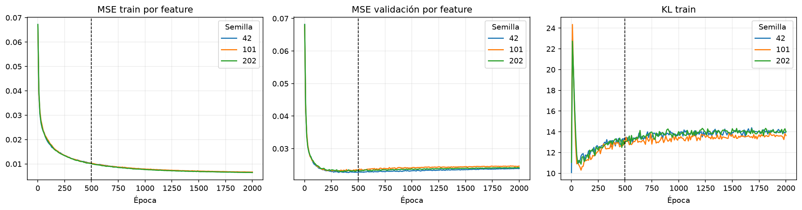
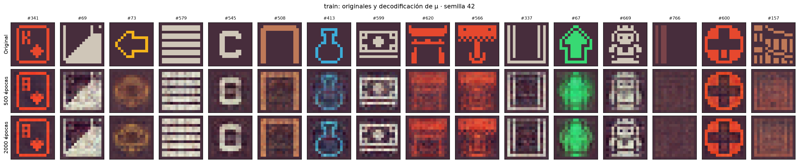
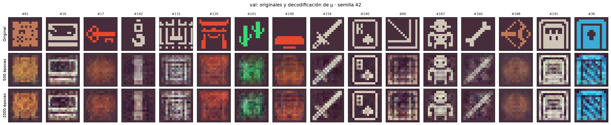
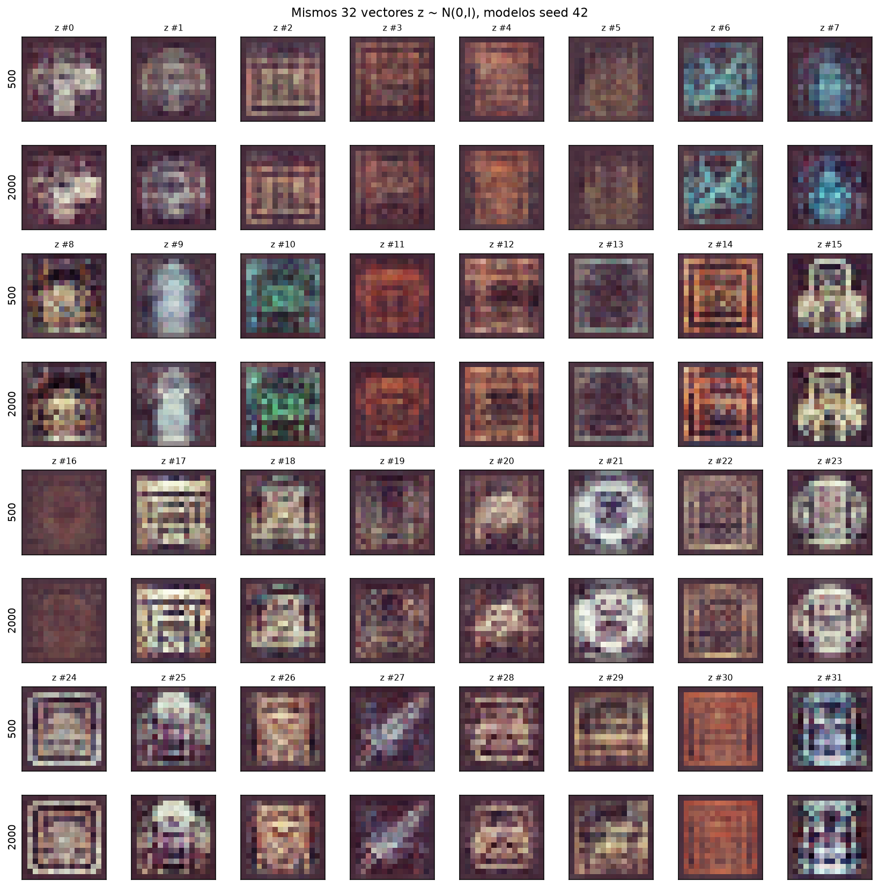
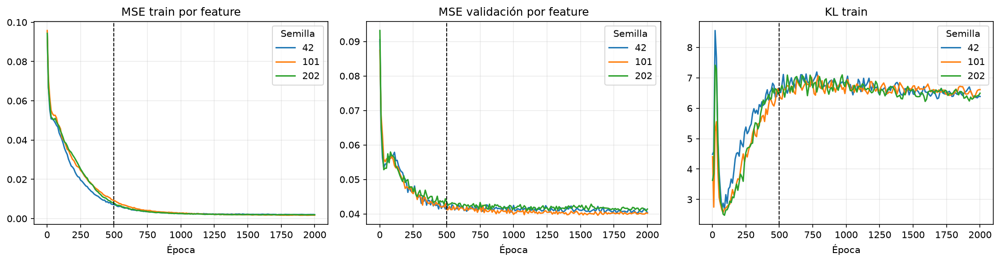
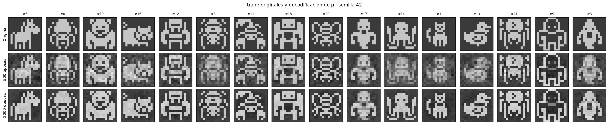
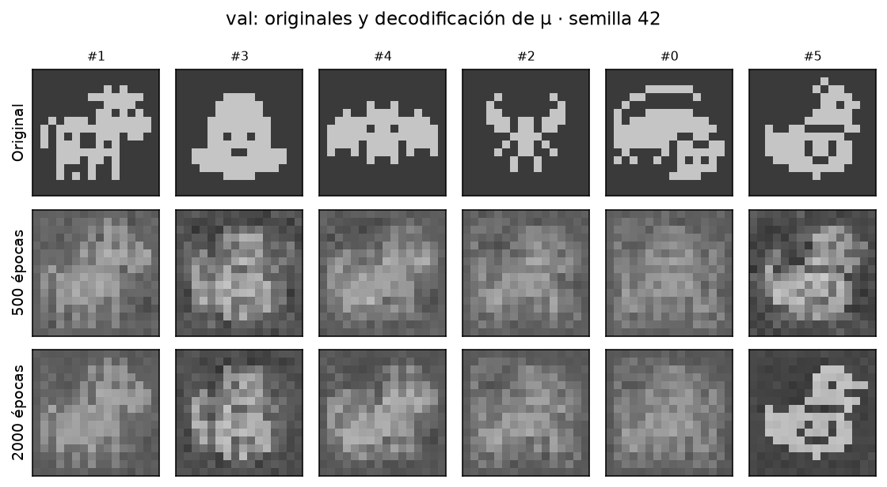
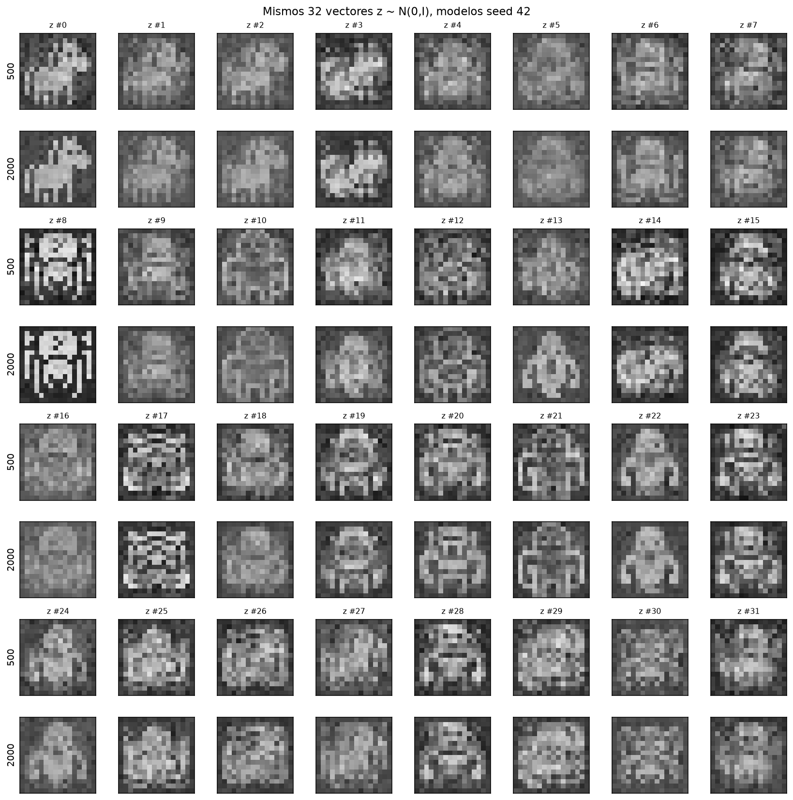
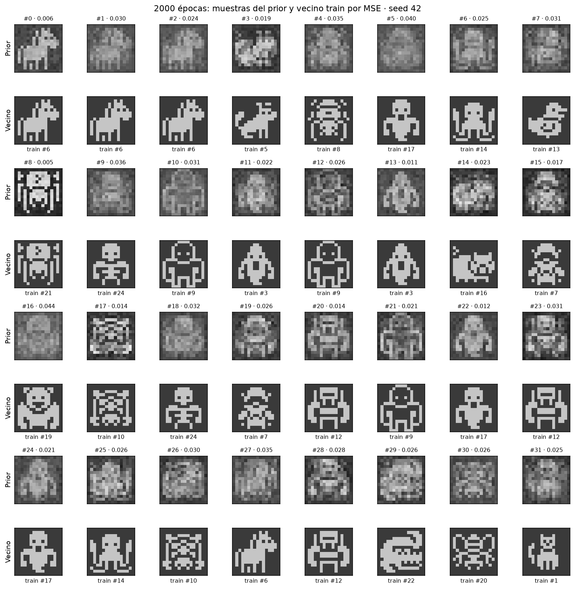

# Más épocas y animales en escala de grises

## Pregunta y protocolo

Se compararon 500 y 2000 épocas con el dataset original RGB y con la región de animales en gris. Se usaron β=0.5, dimensión latente 16, warmup de 50 épocas, Adam y semillas 42, 101 y 202. Dentro de cada dataset las dos corridas tienen la misma arquitectura, datos, inicialización, minibatches y schedule; el historial hasta la época 500 coincide entre las corridas emparejadas. El learning rate sigue decay exponencial (γ=0.999), por lo que las épocas adicionales usan una tasa menor.

- **Dataset original RGB:** 790 sprites train y 197 de validación. La referencia de 500 épocas es la del [experimento anterior](../vae/Explicación.md).
- **Animales en gris:** filas 5–8 y columnas 24–31, con 26 sprites train y 6 de validación. La conversión promedia los canales RGB. Se verificó que los índices de train y validación coinciden con el [experimento de animales RGB](../vae_animals/Explicación.md). Los sprites grises de esta región tienen **sólo dos intensidades**: aproximadamente 0.230 y 0.770.

La reconstrucción se calcula decodificando la media del posterior, `decoder(μ(x))`: es determinista y tiene como entrada un sprite real. Generar desde el prior es diferente: `decoder(z)` con `z ~ N(0,I)`, sin darle un sprite como entrada. Las figuras usan la semilla 42, elegida de antemano, no la mejor por inspección.

## Resultados

MSE promedio por feature en [0,1], media ± desvío estándar muestral entre tres semillas. La validación no se utiliza para actualizar los pesos.

| Dataset | Épocas | Train | Validación | KL train |
|---|---:|---:|---:|---:|
| Original RGB | 500 | 0.01020 ± 0.00009 | **0.02315 ± 0.00038** | 13.10 ± 0.30 |
| Original RGB | 2000 | **0.00658 ± 0.00011** | 0.02421 ± 0.00037 | 13.89 ± 0.21 |
| Animales gris | 500 | 0.00802 ± 0.00107 | 0.04242 ± 0.00110 | 6.54 ± 0.11 |
| Animales gris | 2000 | **0.00190 ± 0.00013** | **0.04066 ± 0.00066** | 6.50 ± 0.11 |

Para el dataset original, más épocas reducen el MSE de train aproximadamente un 35%, pero **empeoran** el de validación aproximadamente un 4.6%. Los mínimos de validación registrados durante las corridas largas aparecieron en las épocas 410, 380 y 330 para las semillas 42, 101 y 202, respectivamente. Son mínimos observados en la misma validación, no una evaluación independiente; no se guardaron pesos de esos mínimos. Es evidencia de sobreajuste, no de que 2000 épocas generalicen mejor.

En animales gris, train mejora mucho, pero la mejora de validación es pequeña y quedan sólo **seis** sprites de validación. La brecha train/validación a 2000 épocas es grande: la reconstrucción casi perfecta de train no implica que haya aprendido a generalizar. Como referencia trivial, predecir la imagen promedio del train da MSE de validación 0.04809 en el dataset original y 0.04479 en animales gris. El VAE mejora esas referencias, pero la última diferencia es modesta.

En el anterior experimento de animales RGB a 500 épocas, β=0.5 y z=16, los MSE normalizados fueron 0.00205 ± 0.00004 en train y 0.04005 ± 0.00161 en validación. No se puede concluir que gris sea mejor: el objetivo cambia al pasar de 768 a 256 features mientras β permanece fijo, además de cambiar los valores de los píxeles. Las arquitecturas también tienen distinta dimensión de entrada y salida.

## ¿Por qué puede parecer tan bueno?

Reconstruir el train no es generar imágenes nuevas. Además, la región de animales tiene sólo 26 ejemplos de entrenamiento y en gris es esencialmente bicolor, de modo que es más fácil memorizar sus formas y paleta. En el dataset completo, algunos sprites de validación son muy parecidos a otros de train: la mediana de la distancia al vecino train por MSE es 0.02409 y el mínimo es 0.00052. La partición por sprite no mide generalización a familias completamente distintas.

El MSE favorece predicciones promedio y no mide directamente nitidez ni plausibilidad. Algunas reconstrucciones y muestras se reconocen; otras mezclan formas, borran detalles o parecen fondo. Las imágenes de abajo permiten juzgarlo sin seleccionar únicamente los mejores casos.

## Dataset original: curvas, reconstrucciones y generación







Cada columna presenta el mismo sprite original y sus reconstrucciones a 500 y 2000 épocas. Los 16 índices se eligen aleatoriamente con semilla fija. También se exportaron **los 790 sprites de train**, en orden, como pares original | reconstrucción a 2000 épocas:

[0–79](./full/train_completo/train_0000_0079.png) · [80–159](./full/train_completo/train_0080_0159.png) · [160–239](./full/train_completo/train_0160_0239.png) · [240–319](./full/train_completo/train_0240_0319.png) · [320–399](./full/train_completo/train_0320_0399.png) · [400–479](./full/train_completo/train_0400_0479.png) · [480–559](./full/train_completo/train_0480_0559.png) · [560–639](./full/train_completo/train_0560_0639.png) · [640–719](./full/train_completo/train_0640_0719.png) · [720–789](./full/train_completo/train_0720_0789.png).



Las filas emparejadas usan exactamente los mismos 32 vectores del prior. A 2000 épocas algunos contornos parecen más definidos, pero todavía hay salidas difusas y no se demuestra una mejora general de calidad. [Ver las muestras a 2000 épocas junto a su vecino de train](./full/prior_vecinos.png).

## Animales gris: curvas, reconstrucciones y generación







[Ver los 26 sprites de train y su reconstrucción a 2000 épocas](./animals_gray/train_completo/train_0000_0025.png). Se observan reconstrucciones train muy nítidas, pero en validación varias salidas son borrosas o se parecen a otro animal.





La segunda figura compara cada una de las 32 muestras de 2000 épocas con el sprite train más cercano por MSE. Algunas salidas reconocibles se parecen mucho a un ejemplo existente, como #0 y #8; otras son mezclas difusas. La distancia pixel a pixel ayuda a inspeccionar similitud, pero no demuestra copia, novedad ni calidad semántica.

## ¿Se llenaron los huecos?

Como diagnóstico indirecto, para cada corrida se compararon 1000 puntos del prior con 1000 puntos muestreados de los posteriores de train; se calculó la distancia euclídea al `μ(x)` de train más cercano en las 16 dimensiones. Las medianas, promediadas entre semillas, fueron:

| Dataset | Épocas | Prior → μ más cercano | Posterior → μ más cercano |
|---|---:|---:|---:|
| Original RGB | 500 | 3.042 | 1.974 |
| Original RGB | 2000 | 3.019 | 2.019 |
| Animales gris | 500 | 3.590 | 2.566 |
| Animales gris | 2000 | 3.542 | 2.636 |

El prior sigue más lejos de las medias de train que los puntos del posterior, y el cambio con más épocas es pequeño. **No se puede afirmar que los huecos se hayan llenado**: esta distancia a centroides ignora la forma y dispersión completas de los posteriores, depende del tamaño del dataset y no mide plausibilidad de las imágenes decodificadas. La tabla es un indicador exploratorio, no una prueba de cobertura.

Los valores detallados, identificadores y las medianas de MSE al vecino de train para 32 muestras están en [`metrics.csv`](./metrics.csv). El `loss` guardado por el entrenador suma reconstrucción determinista y KL sin ponderación por β; no se usó como objetivo ponderado ni como criterio en este informe.

## Reproducir

Desde la raíz, con las dependencias del proyecto instaladas:

```bash
python -m scripts.preprocess_sprites --config configs/dataset_sprites_animals_gray.yaml
# Necesario si todavía no existen los modelos de referencia RGB de 500 épocas:
python -m scripts.sweep --sweep configs/sweeps/vae_sprites.yaml
for seed in 42 101 202; do
  python -m scripts.run --config configs/vae_sprites_full_long.yaml --seed "$seed"
  python -m scripts.run --config configs/vae_sprites_animals_gray.yaml --seed "$seed"
  python -m scripts.run --config configs/vae_sprites_animals_gray_long.yaml --seed "$seed"
done
python -m scripts.analyze_sprites_long
```

Los pesos e historiales están bajo `results/`, directorio ignorado por Git; las figuras, métricas y configuraciones de este informe se conservan por separado. El script valida que las configuraciones emparejadas coincidan salvo por las épocas.
