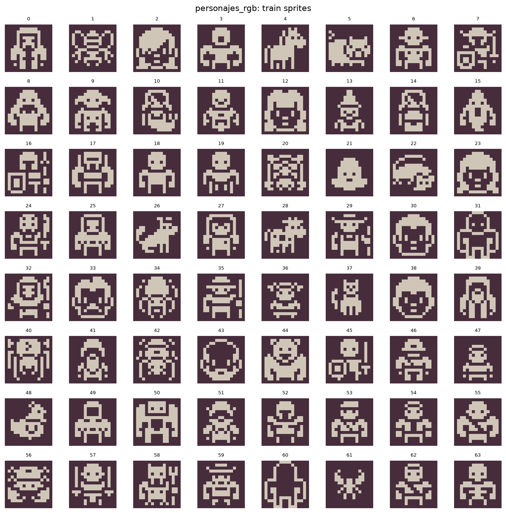
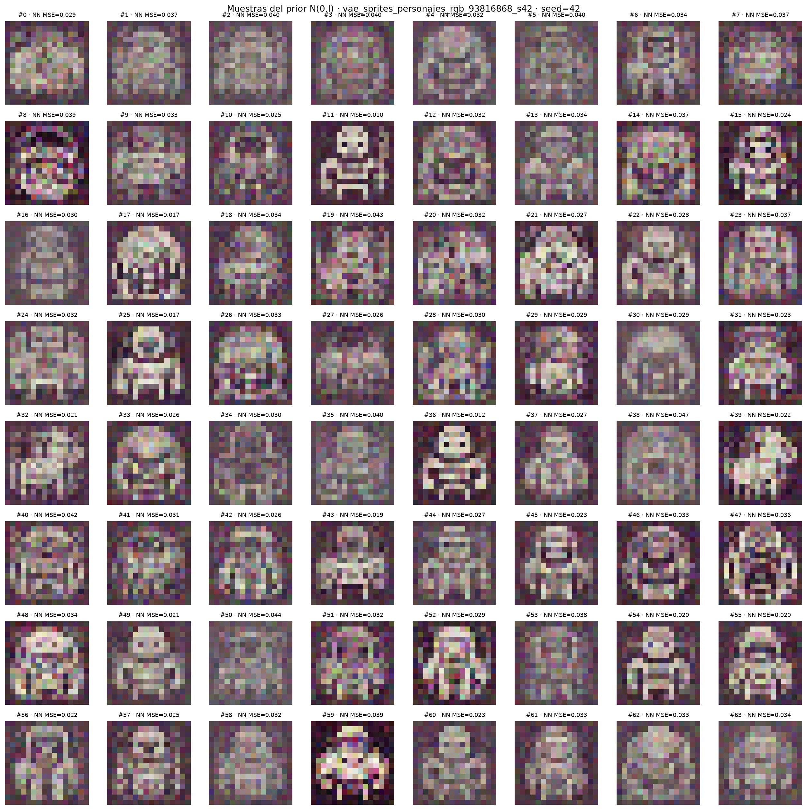
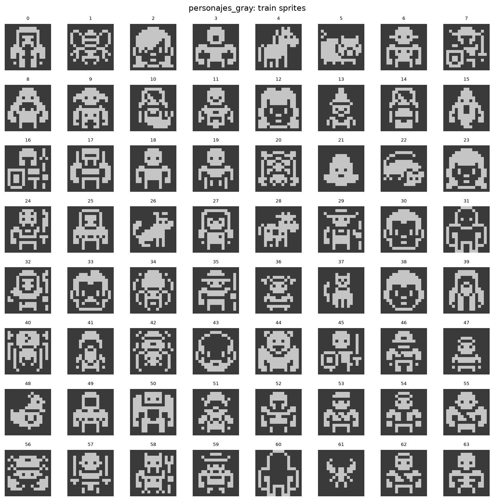
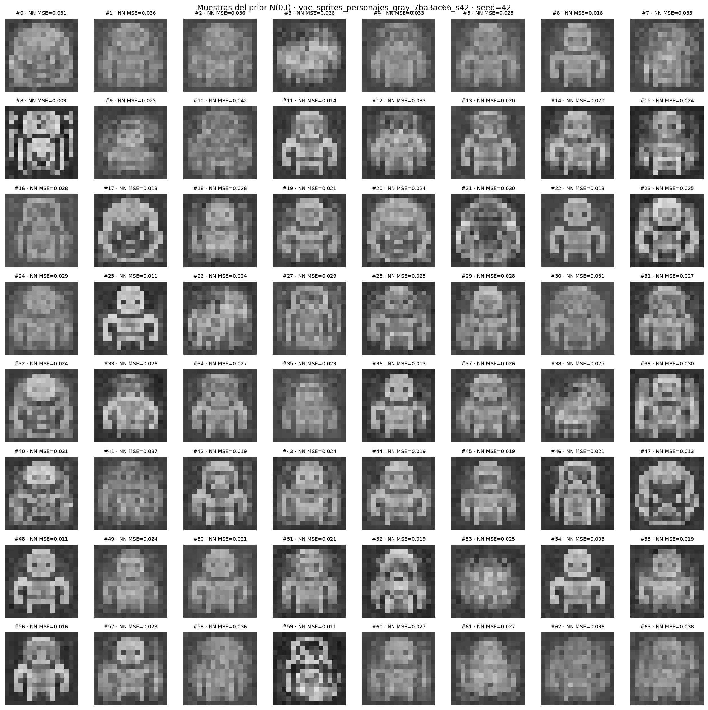
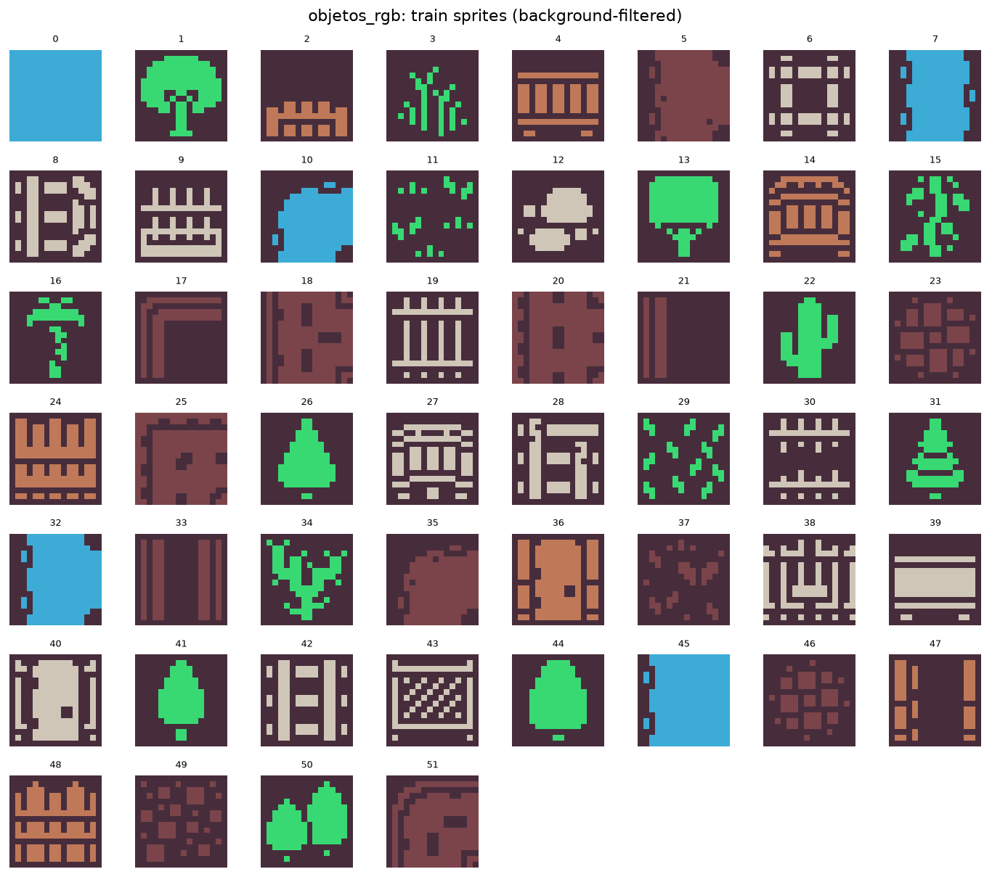
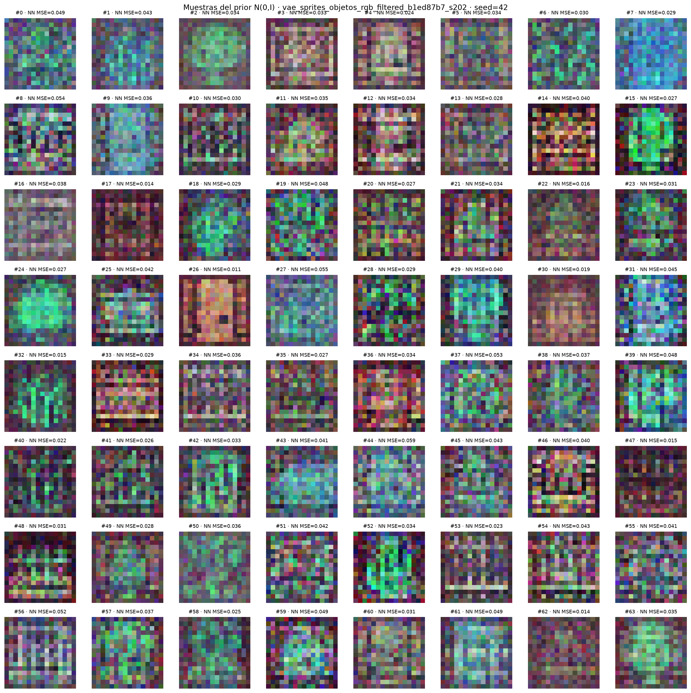
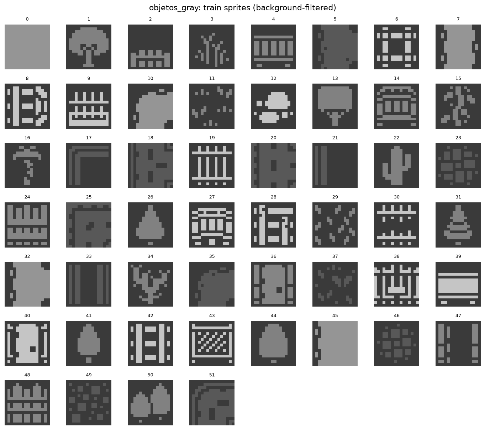
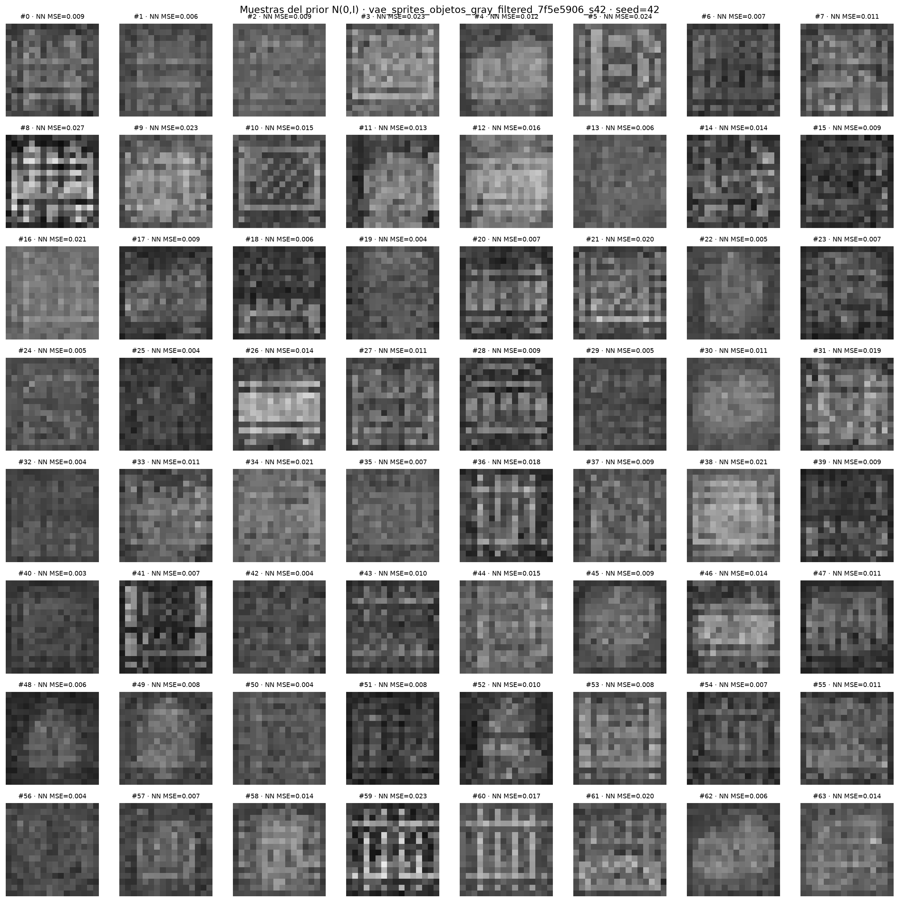

# Generación de sprites: regiones y escala de grises

## Pregunta y protocolo

Se evaluó si el VAE genera sprites plausibles desde el prior normal estándar y cómo influyen el área del tileset y el uso de RGB o escala de grises. Se probaron las regiones indicadas:

- **Personajes:** filas 0–10 y columnas 24–31.
- **Objetos:** filas 0–5 y columnas 0–10.

Los límites de filas y columnas son inclusivos. Cada región se procesó en RGB y en gris, con deduplicación, split reproducible 80/20 (semilla 42) y sin cambiar el dataset RGB completo. La conversión a gris usa el promedio aritmético de R, G y B. El filtro de fondo se aplica después de seleccionar la región; en objetos descartó dos tiles vacíos.

Se entrenó una configuración base por combinación (β=0.5, warmup=50, dimensión latente 16, arquitectura 256–128–16–128–256–salida, Adam, 500 épocas) con semillas 42, 101 y 202. Para objetos se añadió un barrido OFAT de β ∈ {0.1, 1.0} y dimensión latente z=8, manteniendo el resto fijo; la condición base β=0.5, z=16 se reutiliza. En total, los resultados finales contienen 30 corridas únicas: 6 de personajes y 12 por canal para objetos.

Se seleccionó para el muestreo el modelo con menor MSE de validación dentro de la condición de menor MSE medio entre semillas. Se generaron 64 vectores `z ~ N(0,I)` por modelo, usando la semilla 42. Las grillas completas se muestran a continuación. El vecino de entrenamiento más cercano se reporta sólo como una medida pixel a pixel: una distancia baja no demuestra que la salida sea una copia, y una distancia alta no demuestra que sea un sprite plausible.

## Datos y muestras generadas

| Región | Canales | Tiles únicos tras filtrar fondo | Train / validación | Features |
|---|---|---:|---:|---:|
| Personajes | RGB | 88 | 71 / 17 | 768 |
| Personajes | Gris | 88 | 71 / 17 | 256 |
| Objetos | RGB | 64 | 52 / 12 | 768 |
| Objetos | Gris | 64 | 52 / 12 | 256 |

Las imágenes de entrada permiten ver la variedad y la complejidad de cada región antes de evaluar sus muestras generadas.

### Personajes









En ambas representaciones aparecen algunas siluetas de personajes reconocibles, pero muchas muestras son borrosas o mezclan partes. RGB preserva los colores; gris elimina esa información y algunas siluetas se ven más fáciles de distinguir, aunque eso no implica mayor fidelidad en todos los ejemplos.

### Objetos









Los objetos incluyen formas muy distintas —vegetación, cajas, cercas y elementos planos—. Aun usando la mejor condición de validación y reduciendo β a 0.1, las muestras del prior son principalmente texturas y mezclas; **no se encontró una generación nueva que pueda presentarse con confianza como un objeto reconocible**. Por lo tanto, el VAE representa y reconstruye parte de este subset, pero su capacidad generativa desde el prior sigue siendo débil.

## Error de reconstrucción

El MSE original suma el error sobre las features de cada sprite; por eso no se comparan directamente los totales RGB y gris. La tabla informa MSE de validación **por feature** (MSE total dividido por 768 en RGB o 256 en gris), media ± desvío estándar muestral entre tres semillas.

| Región | Canales | β | z | MSE de validación por feature |
|---|---|---:|---:|---:|
| Personajes | RGB | 0.5 | 16 | 0.02829 ± 0.00046 |
| Personajes | Gris | 0.5 | 16 | 0.03338 ± 0.00044 |
| Objetos | RGB | 0.1 | 16 | **0.02113 ± 0.00073** |
| Objetos | RGB | 0.5 | 8 | 0.02290 ± 0.00030 |
| Objetos | RGB | 0.5 | 16 | 0.02239 ± 0.00055 |
| Objetos | RGB | 1.0 | 16 | 0.02694 ± 0.00062 |
| Objetos | Gris | 0.1 | 16 | **0.02017 ± 0.00216** |
| Objetos | Gris | 0.5 | 8 | 0.02296 ± 0.00209 |
| Objetos | Gris | 0.5 | 16 | 0.03246 ± 0.00433 |
| Objetos | Gris | 1.0 | 16 | 0.04151 ± 0.00424 |

Para objetos, β=0.1 mejora la reconstrucción de validación frente a β=0.5 y β=1.0 en las dos representaciones. La validación contiene sólo 12 sprites, por lo que estos resultados son comparaciones exploratorias, no una estimación sólida de generalización. Menor error de reconstrucción tampoco implica mejor muestreo desde el prior.

En las 64 muestras del prior de cada modelo seleccionado, el MSE medio al vecino de entrenamiento más cercano fue:

| Región | Canales | MSE vecino medio ± desvío | Rango |
|---|---|---:|---:|
| Personajes | RGB | 0.03017 ± 0.00779 | 0.00971–0.04734 |
| Personajes | Gris | 0.02421 ± 0.00772 | 0.00848–0.04162 |
| Objetos | RGB | 0.03420 ± 0.01091 | 0.01143–0.05904 |
| Objetos | Gris | 0.01129 ± 0.00607 | 0.00340–0.02654 |

En objetos grises, la menor distancia al train concuerda con muestras más parecidas a las imágenes fuente, pero muchas siguen borrosas. No se toma la distancia como una métrica de calidad o novedad semántica.

## Conclusiones

1. El subset de personajes permite generar algunas formas reconocibles, aunque la calidad no es consistente. La evaluación RGB/gris es visual y exploratoria; tres semillas y un split pequeño no establecen que gris sea universalmente superior.
2. Para objetos, la mejor reconstrucción se obtuvo con β=0.1, pero las muestras del prior no resultaron suficientemente claras para afirmar que el VAE genere objetos nuevos convincentes.
3. La escala de grises reduce el tamaño de entrada/salida de 768 a 256 features y elimina la información de color. En este experimento no resolvió por sí sola el problema de generación.
4. Se detectó y corrigió el preprocesamiento regional: antes no descartaba tiles vacíos cuando `regions` estaba configurado. Los sweeps finales de objetos se ejecutaron después de excluir los dos fondos.
5. Si el requisito es presentar una muestra generada que pertenezca al dataset, estos experimentos de objetos no alcanzan ese criterio; conviene conservar el resultado de personajes y describir honestamente esta limitación.

## Reproducibilidad

Desde la raíz del repositorio:

```bash
python scripts/preprocess_sprites.py --config configs/dataset_sprites_personajes_rgb.yaml
python scripts/preprocess_sprites.py --config configs/dataset_sprites_personajes_gray.yaml
python scripts/preprocess_sprites.py --config configs/dataset_sprites_objetos_rgb.yaml
python scripts/preprocess_sprites.py --config configs/dataset_sprites_objetos_gray.yaml

python scripts/sweep.py --sweep configs/sweeps/vae_sprites_personajes_rgb.yaml
python scripts/sweep.py --sweep configs/sweeps/vae_sprites_personajes_gray.yaml
python scripts/sweep.py --sweep configs/sweeps/vae_sprites_objetos_rgb.yaml
python scripts/sweep.py --sweep configs/sweeps/vae_sprites_objetos_gray.yaml
python scripts/sweep.py --sweep configs/sweeps/vae_sprites_objetos_rgb_generation.yaml
python scripts/sweep.py --sweep configs/sweeps/vae_sprites_objetos_gray_generation.yaml

python scripts/generate.py --mode sample \
  --run results/sprites_generation/personajes_rgb/runs/vae_sprites_personajes_rgb_93816868_s42 \
  --output-dir figures/vae_regions/personajes_rgb --n-samples 64 --seed 42
python scripts/generate.py --mode sample \
  --run results/sprites_generation/personajes_gray/runs/vae_sprites_personajes_gray_7ba3ac66_s42 \
  --output-dir figures/vae_regions/personajes_gray --n-samples 64 --seed 42
```

Para objetos, usar los mejores modelos del barrido ajustado (β=0.1, z=16):

```bash
python scripts/generate.py --mode sample \
  --run results/sprites_generation/objetos_rgb_filtered/runs/vae_sprites_objetos_rgb_filtered_b1ed87b7_s202 \
  --output-dir figures/vae_regions/objetos_rgb --n-samples 64 --seed 42
python scripts/generate.py --mode sample \
  --run results/sprites_generation/objetos_gray_filtered/runs/vae_sprites_objetos_gray_filtered_7f5e5906_s42 \
  --output-dir figures/vae_regions/objetos_gray --n-samples 64 --seed 42
```
